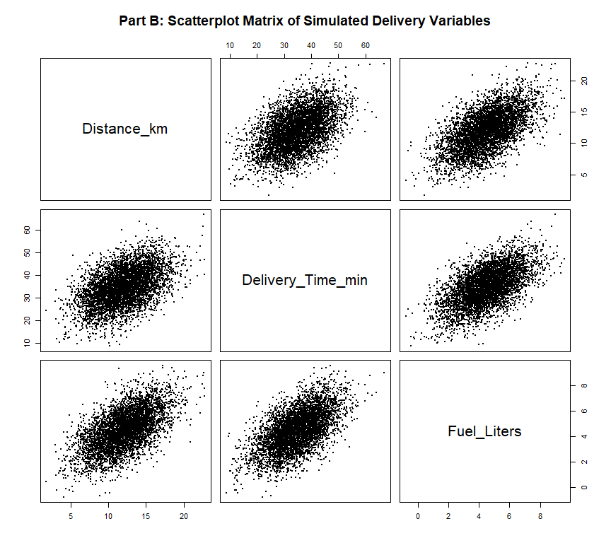
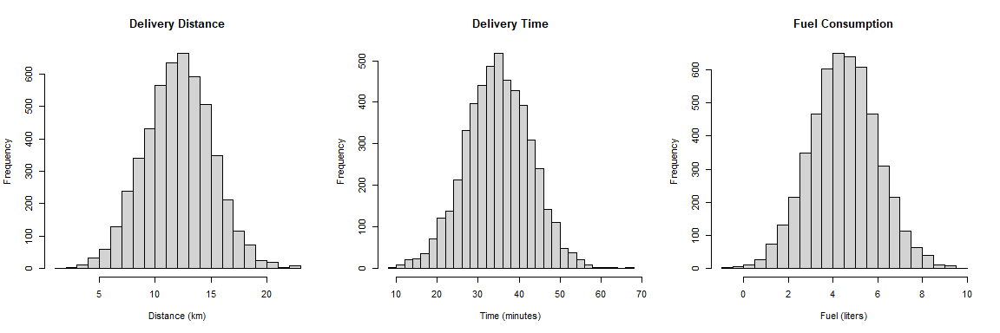
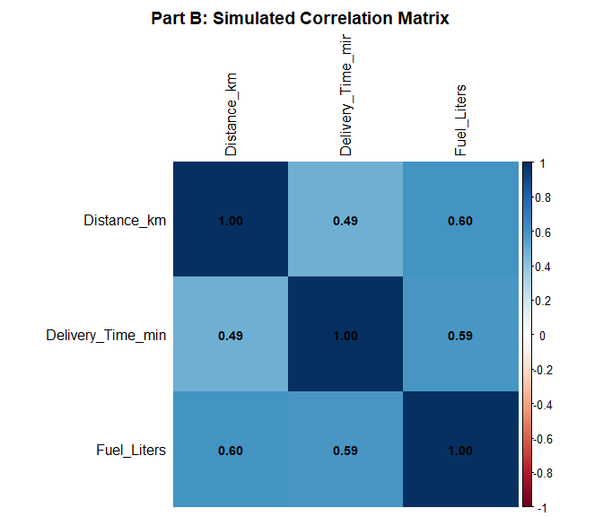
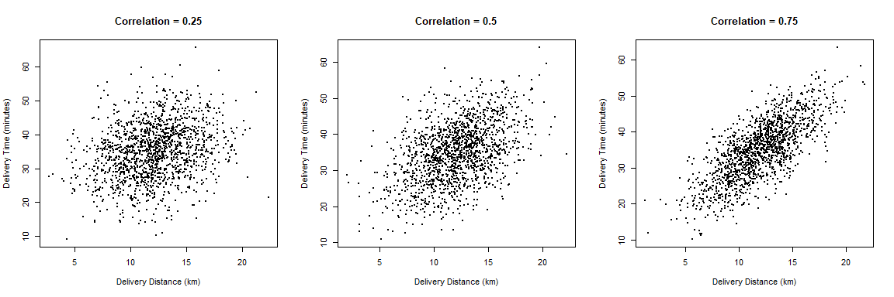
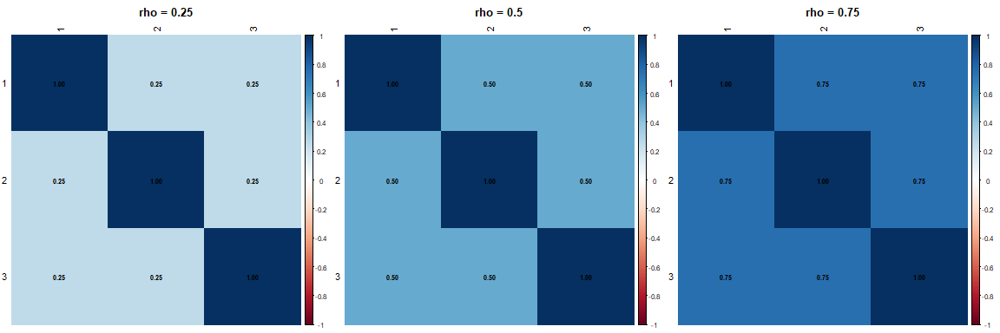
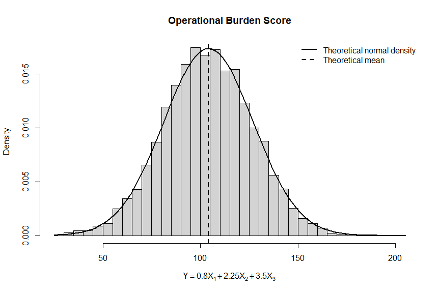
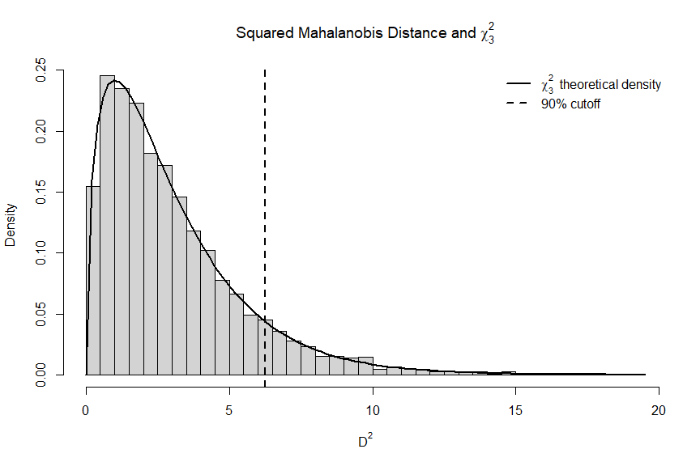
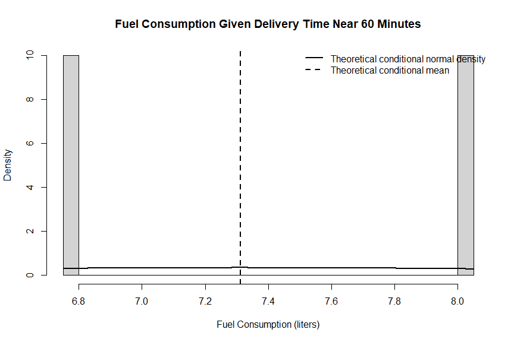

FA3
================
Espiritu, Joseph Raphael, M.
2026-08-28

# Part A. Define Your Multivariate Normal Distribution — 6 points

We define our simulated population as

$$X\sim N_3(\mu,\Sigma).$$

This notation describes the **joint distribution of our three
variables**.

Here, $X$ is a random vector containing the three delivery-operation
variables:

$$X=
\begin{bmatrix}
X_1\\
X_2\\
X_3
\end{bmatrix}
=
\begin{bmatrix}
\text{Distance}\\
\text{Delivery Time}\\
\text{Fuel Used}
\end{bmatrix}.$$

The three components are defined as

$$X_1=\text{delivery distance (km)},$$

$$X_2=\text{delivery time (minutes)},$$

$$X_3=\text{fuel consumed (liters)}.$$

The subscript $3$ in $N_3$ indicates that the distribution has **three
variables or dimensions**.

The vector $\mu$ represents the **mean vector**, which determines the
center of the distribution:

$$\mu=
\begin{bmatrix}
\mu_1\\
\mu_2\\
\mu_3
\end{bmatrix}.$$

The matrix $\Sigma$ represents the **covariance matrix**. Its diagonal
elements describe the individual variances of the three variables, while
its off-diagonal elements describe how pairs of variables vary together.

Therefore,

$$X\sim N_3(\mu,\Sigma)$$

means that we are modeling the three delivery variables **jointly**,
with their center determined by $\mu$ and their variability and
relationships determined by $\Sigma$.

For this simulation, we use a delivery operations scenario because
distance, delivery time, and fuel consumption have a reasonable
operational relationship. A longer delivery distance can generally
require more time and fuel, so we expect positive relationships among
these variables.

## A.1 The Variables and Their Interpretation

Our random vector is

$$X=
\begin{bmatrix}
X_1\\
X_2\\
X_3
\end{bmatrix}
=
\begin{bmatrix}
\text{Distance}\\
\text{Delivery Time}\\
\text{Fuel Used}
\end{bmatrix}.$$

The three variables are summarized below.

| Variable          | Symbol | Unit    | Interpretation                         |
|:------------------|:------:|:--------|:---------------------------------------|
| Delivery distance | $X_1$  | km      | Distance traveled for a delivery       |
| Delivery time     | $X_2$  | minutes | Time required to complete the delivery |
| Fuel consumed     | $X_3$  | liters  | Fuel used during the delivery          |

The purpose of defining these variables together is to investigate not
only their individual distributions but also how they vary **jointly**
through covariance and correlation.

## A.2 The Mean Vector $\mu$

We choose the following theoretical mean vector:

$$\mu=
\begin{bmatrix}
12\\
35\\
4.5
\end{bmatrix}.$$

This means that the theoretical population has:

- an average delivery distance of $12$ km;
- an average delivery time of $35$ minutes;
- an average fuel consumption of $4.5$ L.

Thus, the center of our simulated population is

$$\boxed{\mu=(12,35,4.5)' }.$$

We define the mean vector in R as follows:

``` r
mu <- c(
  Distance_km = 12,
  Delivery_Time_min = 35,
  Fuel_Liters = 4.5
)

mu
```

    ##       Distance_km Delivery_Time_min       Fuel_Liters 
    ##              12.0              35.0               4.5

## A.3 The Covariance Matrix $\Sigma$

We choose the covariance matrix

$$\Sigma=
\begin{bmatrix}
9 & 12 & 2.7\\
12 & 64 & 7.2\\
2.7 & 7.2 & 2.25
\end{bmatrix}.$$

The diagonal elements represent the variances of the three variables:

$$\operatorname{Var}(X_1)=9,$$

$$\operatorname{Var}(X_2)=64,$$

$$\operatorname{Var}(X_3)=2.25.$$

Therefore, their theoretical standard deviations are

$$\sigma_1=\sqrt{9}=3,$$

$$\sigma_2=\sqrt{64}=8,$$

$$\sigma_3=\sqrt{2.25}=1.5.$$

The off-diagonal elements represent the covariances between the
variables:

$$\operatorname{Cov}(X_1,X_2)=12,$$

$$\operatorname{Cov}(X_1,X_3)=2.7,$$

$$\operatorname{Cov}(X_2,X_3)=7.2.$$

All three covariances are positive, indicating that larger values of one
variable tend to be associated with larger values of the other variable.
For example, longer delivery distances tend to be associated with longer
delivery times and greater fuel consumption.

We define the covariance matrix in R:

``` r
Sigma <- matrix(
  c(
    9, 12, 2.7,
    12, 64, 7.2,
    2.7, 7.2, 2.25
  ),
  nrow = 3,
  byrow = TRUE
)

rownames(Sigma) <- names(mu)
colnames(Sigma) <- names(mu)

Sigma
```

    ##                   Distance_km Delivery_Time_min Fuel_Liters
    ## Distance_km               9.0              12.0        2.70
    ## Delivery_Time_min        12.0              64.0        7.20
    ## Fuel_Liters               2.7               7.2        2.25

Our simulated population is therefore

$$\boxed{
X\sim
N_3
\left(
\begin{bmatrix}
12\\
35\\
4.5
\end{bmatrix},
\begin{bmatrix}
9 & 12 & 2.7\\
12 & 64 & 7.2\\
2.7 & 7.2 & 2.25
\end{bmatrix}
\right)
}.$$

## A.4 The Corresponding Correlation Matrix

Covariance depends on the measurement scales of the variables. To
describe the strength of the linear relationships in a standardized
form, we calculate the correlation matrix.

The correlation between two variables is

$$\rho_{ij}
=
\frac{\sigma_{ij}}
{\sqrt{\sigma_{ii}\sigma_{jj}}}.$$

For delivery distance and delivery time,

$$\rho_{12}
=
\frac{12}{\sqrt{9(64)}}
=
\frac{12}{24}
=
0.50.$$

For delivery distance and fuel consumption,

$$\rho_{13}
=
\frac{2.7}{\sqrt{9(2.25)}}
=
0.60.$$

For delivery time and fuel consumption,

$$\rho_{23}
=
\frac{7.2}{\sqrt{64(2.25)}}
=
0.60.$$

Therefore, the theoretical correlation matrix is

$$R=
\begin{bmatrix}
1 & 0.50 & 0.60\\
0.50 & 1 & 0.60\\
0.60 & 0.60 & 1
\end{bmatrix}.$$

We calculate it in R using `cov2cor()`:

``` r
R_theoretical <- cov2cor(Sigma)

round(R_theoretical, 3)
```

    ##                   Distance_km Delivery_Time_min Fuel_Liters
    ## Distance_km               1.0               0.5         0.6
    ## Delivery_Time_min         0.5               1.0         0.6
    ## Fuel_Liters               0.6               0.6         1.0

The positive correlations mean that we expect an upward relationship
between the variables in the simulated data. In particular, the
correlations of $0.60$ indicate somewhat stronger positive relationships
than the correlation of $0.50$. Unlike covariance, correlation is
standardized and therefore provides a more directly comparable measure
of linear relationship between variables with different units.

## A.5 Why Is Our Covariance Matrix Appropriate?

The covariance matrix is appropriate for our simulation for several
reasons.

First, it is **symmetric**, since

$$\Sigma=\Sigma'.$$

This is necessary for a covariance matrix.

``` r
is_symmetric <- isTRUE(all.equal(Sigma, t(Sigma)))

is_symmetric
```

    ## [1] TRUE

Second, the covariance matrix must be positive definite for our
multivariate normal model. We can check this using its eigenvalues.

``` r
eigenvalues <- eigen(Sigma, symmetric = TRUE)$values

round(eigenvalues, 6)
```

    ## [1] 67.391100  6.747335  1.111565

All of the eigenvalues are positive, so $\Sigma$ is positive definite.

We can also check that its determinant is positive:

``` r
det(Sigma)
```

    ## [1] 505.44

The determinant is also positive, which is consistent with the matrix
being valid. More importantly, the positive eigenvalues confirm that
$\Sigma$ is positive definite.

From a scenario perspective, the matrix is also appropriate because its
positive covariance values represent the expected operational
relationships among distance, delivery time, and fuel consumption.

Therefore, the covariance matrix is mathematically valid because it is
symmetric and positive definite, and it is also reasonable for our
logistics scenario because its positive covariance values represent
plausible relationships among distance, delivery time, and fuel
consumption.

# Part B. Generate and Explore the Simulated Data — 8 points

In Part A, we defined our theoretical population as

$$X\sim N_3(\mu,\Sigma),$$

with

$$\mu=
\begin{bmatrix}
12\\
35\\
4.5
\end{bmatrix}$$

and

$$\Sigma=
\begin{bmatrix}
9&12&2.7\\
12&64&7.2\\
2.7&7.2&2.25
\end{bmatrix}.$$

In Part B, we now generate a random sample from this population.

The purpose of this simulation is to determine whether the sample
statistics and graphical patterns are reasonably consistent with the
theoretical parameters that we specified in Part A.

## B.1 Generate the Simulated Data

The FA3 instructions require at least

$$n=1000$$

observations. We use

$$\boxed{n=5000}$$

for our simulation.

We use 5,000 observations so that we have a sufficiently large sample
for comparing the simulated statistics with the theoretical population
parameters.

Each observation contains three values:

$$(X_1,X_2,X_3),$$

representing delivery distance, delivery time, and fuel consumption.

We generate the observations using the same $\mu$ and $\Sigma$ that we
defined in Part A.

``` r
n <- 5000

X <- MASS::mvrnorm(
  n = n,
  mu = mu,
  Sigma = Sigma
)

X <- as.data.frame(X)

colnames(X) <- names(mu)

head(X)
```

    ##   Distance_km Delivery_Time_min Fuel_Liters
    ## 1   10.550883          39.30396    3.388719
    ## 2    6.785717          32.74471    5.585550
    ## 3    9.155493          34.20248    5.261825
    ## 4   11.511376          36.02922    2.916418
    ## 5    9.973784          28.37028    4.869651
    ## 6   10.467137          27.78221    4.658685

The resulting dataset contains 5,000 simulated delivery observations and
three variables.

We can also check the dimensions of the simulated dataset:

``` r
dim(X)
```

    ## [1] 5000    3

The expected result is

$$5000\times3,$$

because there are 5,000 observations and three variables.

## B.2 Simulated Means

In Part A, we specified the theoretical mean vector as

$$\mu=
\begin{bmatrix}
12\\
35\\
4.5
\end{bmatrix}.$$

We now calculate the corresponding means from the simulated sample.

The sample mean vector is

$$\bar X=
\begin{bmatrix}
\bar X_1\\
\bar X_2\\
\bar X_3
\end{bmatrix}.$$

``` r
sample_means <- colMeans(X)

round(sample_means, 3)
```

    ##       Distance_km Delivery_Time_min       Fuel_Liters 
    ##            12.038            34.820             4.482

### What do we expect?

Because the observations were generated from the population with mean
vector $\mu$, we expect

$$\bar X\approx\mu.$$

Therefore, we expect the simulated means to be reasonably close to

$$12,\quad35,\quad4.5.$$

## B.3 Simulated Variances

The diagonal elements of our theoretical covariance matrix from Part A
are

$$\sigma_{11}=9,$$

$$\sigma_{22}=64,$$

and

$$\sigma_{33}=2.25.$$

Therefore, the theoretical variances are

$$9,\quad64,\quad2.25.$$

We calculate the sample variances from the simulated observations.

``` r
sample_variances <- sapply(X, var)

round(sample_variances, 3)
```

    ##       Distance_km Delivery_Time_min       Fuel_Liters 
    ##             9.101            62.714             2.258

We expect

$$S_{11}\approx9,$$

$$S_{22}\approx64,$$

and

$$S_{33}\approx2.25.$$

Again, the simulated values will not necessarily be exactly equal to the
theoretical values because of random sampling.

## B.4 Simulated Covariance Matrix

We now calculate the covariance matrix of the simulated observations.

``` r
sample_covariances <- cov(X)

round(sample_covariances, 3)
```

    ##                   Distance_km Delivery_Time_min Fuel_Liters
    ## Distance_km             9.101            11.648       2.705
    ## Delivery_Time_min      11.648            62.714       7.003
    ## Fuel_Liters             2.705             7.003       2.258

Recall that the theoretical covariance matrix from Part A is

$$\Sigma=
\begin{bmatrix}
9&12&2.7\\
12&64&7.2\\
2.7&7.2&2.25
\end{bmatrix}.$$

Therefore, we expect the simulated covariance matrix to be reasonably
close to $\Sigma$.

In particular, we expect the off-diagonal elements to remain positive:

$$S_{12}\approx12,$$

$$S_{13}\approx2.7,$$

$$S_{23}\approx7.2.$$

This would indicate that the simulated variables retain the positive
relationships specified in Part A.

## B.5 Simulated Correlation Matrix

In Part A, we calculated the theoretical correlation matrix

$$R=
\begin{bmatrix}
1&0.50&0.60\\
0.50&1&0.60\\
0.60&0.60&1
\end{bmatrix}.$$

We now calculate the correlation matrix from the simulated observations.

``` r
sample_correlations <- cor(X)

round(sample_correlations, 3)
```

    ##                   Distance_km Delivery_Time_min Fuel_Liters
    ## Distance_km             1.000             0.488       0.597
    ## Delivery_Time_min       0.488             1.000       0.589
    ## Fuel_Liters             0.597             0.589       1.000

We expect the simulated correlations to be close to the theoretical
values:

$$\rho_{12}=0.50,$$

$$\rho_{13}=0.60,$$

$$\rho_{23}=0.60.$$

The diagonal entries are 1 because each variable has a correlation of 1
with itself.

The important values for examining dependence between different
variables are the off-diagonal entries.

## B.6 Theoretical versus Simulated Results

We now combine the theoretical and simulated means and variances into
one table.

``` r
comparison <- data.frame(
  Variable = names(mu),
  Theoretical_Mean = as.numeric(mu),
  Simulated_Mean = as.numeric(sample_means),
  Theoretical_Variance = diag(Sigma),
  Simulated_Variance = as.numeric(sample_variances)
)

comparison$Mean_Difference <-
  comparison$Simulated_Mean -
  comparison$Theoretical_Mean

comparison$Variance_Difference <-
  comparison$Simulated_Variance -
  comparison$Theoretical_Variance

knitr::kable(
  comparison,
  digits = 3,
  caption = "Theoretical versus simulated means and variances"
)
```

|  | Variable | Theoretical_Mean | Simulated_Mean | Theoretical_Variance | Simulated_Variance | Mean_Difference | Variance_Difference |
|:---|:---|---:|---:|---:|---:|---:|---:|
| Distance_km | Distance_km | 12.0 | 12.038 | 9.00 | 9.101 | 0.038 | 0.101 |
| Delivery_Time_min | Delivery_Time_min | 35.0 | 34.820 | 64.00 | 62.714 | -0.180 | -1.286 |
| Fuel_Liters | Fuel_Liters | 4.5 | 4.482 | 2.25 | 2.258 | -0.018 | 0.008 |

Theoretical versus simulated means and variances

We can also compare the theoretical and simulated correlation matrices
directly.

``` r
correlation_comparison <- data.frame(
  Variable_Pair = c(
    "Distance - Delivery Time",
    "Distance - Fuel",
    "Delivery Time - Fuel"
  ),
  Theoretical_Correlation = c(
    R_theoretical[1, 2],
    R_theoretical[1, 3],
    R_theoretical[2, 3]
  ),
  Simulated_Correlation = c(
    sample_correlations[1, 2],
    sample_correlations[1, 3],
    sample_correlations[2, 3]
  )
)

correlation_comparison$Difference <-
  correlation_comparison$Simulated_Correlation -
  correlation_comparison$Theoretical_Correlation

knitr::kable(
  correlation_comparison,
  digits = 3,
  caption = "Theoretical versus simulated correlations"
)
```

| Variable_Pair | Theoretical_Correlation | Simulated_Correlation | Difference |
|:---|---:|---:|---:|
| Distance - Delivery Time | 0.5 | 0.488 | -0.012 |
| Distance - Fuel | 0.6 | 0.597 | -0.003 |
| Delivery Time - Fuel | 0.6 | 0.589 | -0.011 |

Theoretical versus simulated correlations

### Why are we comparing these values?

Part A gave us the **theoretical population parameters**.

Part B gives us a **random sample from that population**.

Therefore, we are checking whether

$$\bar X\approx\mu$$

and

$$S\approx\Sigma.$$

Overall, the simulated means, variances, covariances, and correlations
are reasonably close to their theoretical counterparts. The small
differences are expected from random sampling and do not indicate a
problem with the simulation.

# B.7 Visualization: Scatterplot Matrix

``` r
pairs(
  X,
  main = "Part B: Scatterplot Matrix of Simulated Delivery Variables",
  pch = 16,
  cex = 0.45
)
```

<!-- -->

### What are we looking for?

The scatterplot matrix allows us to examine the relationships between
each pair of variables.

From Part A, we specified positive correlations:

$$\rho_{12}=0.50,
\qquad
\rho_{13}=0.60,
\qquad
\rho_{23}=0.60.$$

Therefore, we expect the pairwise point clouds to generally have an
**upward orientation**.

The relationships with correlation $0.60$ should show a somewhat
stronger linear pattern than the relationship with correlation $0.50$.

The scatterplot matrix shows upward-oriented point clouds for all three
variable pairs, which is consistent with the positive correlations
specified in Part A. The relationships involving fuel consumption appear
somewhat stronger than the distance–delivery-time relationship,
consistent with the theoretical correlations of 0.60 compared with 0.50.

# B.8 Visualization: Histograms

We now examine the three variables individually using histograms.

``` r
par(mfrow = c(1, 3))

hist(
  X$Distance_km,
  breaks = 30,
  main = "Delivery Distance",
  xlab = "Distance (km)"
)

hist(
  X$Delivery_Time_min,
  breaks = 30,
  main = "Delivery Time",
  xlab = "Time (minutes)"
)

hist(
  X$Fuel_Liters,
  breaks = 30,
  main = "Fuel Consumption",
  xlab = "Fuel (liters)"
)
```

<!-- -->

``` r
par(mfrow = c(1, 1))
```

These histograms allow us to examine the individual variables.

$$12,\quad35,\quad4.5.$$

The three histograms are approximately bell-shaped and centered near
their theoretical means of 12 km, 35 minutes, and 4.5 L. Their spreads
are also consistent with the theoretical standard deviations of 3, 8,
and 1.5. This provides visual evidence that the individual simulated
variables follow the intended normal distributions.

The histograms provide a univariate view, while the scatterplot matrix
from the previous section allows us to examine the variables jointly.

# B.9 Visualization: Correlation Matrix

We can also visualize the simulated correlation matrix.

First, install the `corrplot` package if it has not already been
installed:

``` r
install.packages("corrplot")
```

Then load the package:

``` r
library(corrplot)
```

We can now create a correlation plot:

``` r
corrplot(
  sample_correlations,
  method = "color",
  addCoef.col = "black",
  tl.col = "black",
  number.cex = 0.9,
  title = "Part B: Simulated Correlation Matrix",
  mar = c(0, 0, 2, 0)
)
```

<!-- -->

The correlation plot is a visual representation of the same correlation
matrix calculated earlier using

``` r
cor(X)
```

The diagonal entries are 1 because each variable is perfectly correlated
with itself.

The off-diagonal entries are the relationships that we are most
interested in:

$$\rho_{12},
\qquad
\rho_{13},
\qquad
\rho_{23}.$$

The simulated correlation plot shows positive off-diagonal correlations
for all three variable pairs, with values of approximately 050, 0.60,
and 0.59. This visually confirms the positive dependence observed
numerically in the correlation matrix.

# B.10 Part B Interpretation

The simulation generated 5,000 observations from the multivariate normal
population defined in Part A.

The theoretical mean vector was

$$\mu=
\begin{bmatrix}
12\\
35\\
4.5
\end{bmatrix},$$

and the theoretical covariance matrix was

$$\Sigma=
\begin{bmatrix}
9&12&2.7\\
12&64&7.2\\
2.7&7.2&2.25
\end{bmatrix}.$$

The simulated means can be compared with the theoretical means, while
the simulated variances and covariances can be compared with the
corresponding elements of $\Sigma$.

The simulated correlations can also be compared with the theoretical
values

$$0.50,\quad0.60,\quad0.60.$$

Overall, the simulation successfully reproduces the theoretical
population defined in Part A. The simulated means are very close to 12,
35, and 4.5, while the simulated variances, covariances, and
correlations are also reasonably close to their theoretical values. The
scatterplot matrix shows the expected positive relationships, and the
histograms show approximately normal individual distributions centered
near their theoretical means. These results indicate that the 5,000
simulated observations behave consistently with the specified
multivariate normal model.

# Part C. Investigate the Effect of Correlation — 7 points

In Part A, we defined the covariance and correlation structure of our
delivery-operation variables. In Part B, we generated observations from
that distribution and examined the resulting relationships.

In this part, we want to investigate more directly:

> **How does changing the correlation affect the shape and orientation
> of the simulated observations?**

$$\boxed{\rho=0.25,\qquad \rho=0.50,\qquad \rho=0.75}.$$

These values allow us to observe a gradual increase in positive
correlation:

- $\rho=0.25$: weak positive correlation;
- $\rho=0.50$: moderate positive correlation;
- $\rho=0.75$: strong positive correlation.

The purpose is to see how these different correlation structures affect
the simulated observations.

## C.1 Keep the Other Parameters Controlled

To investigate the effect of correlation, we keep the other parameters
from Part A fixed.

Our mean vector remains

$$\mu=
\begin{bmatrix}
12\\
35\\
4.5
\end{bmatrix}.$$

The standard deviations also remain fixed:

$$\sigma_1=3,\qquad
\sigma_2=8,\qquad
\sigma_3=1.5.$$

Therefore, the main parameter that changes between our three simulations
is the correlation.

This allows us to make a more direct comparison between the three
simulated distributions.

``` r
correlation_levels <- c(0.25, 0.50, 0.75)

standard_deviations <- sqrt(diag(Sigma))

standard_deviations
```

    ##       Distance_km Delivery_Time_min       Fuel_Liters 
    ##               3.0               8.0               1.5

## C.2 Construct the Correlation Matrices

For each selected value of $\rho$, we construct a correlation matrix of
the form

$$R_\rho=
\begin{bmatrix}
1&\rho&\rho\\
\rho&1&\rho\\
\rho&\rho&1
\end{bmatrix}.$$

The diagonal entries remain 1 because each variable is perfectly
correlated with itself.

The off-diagonal entries are the correlations between different
variables, and these are what we change.

For $\rho=0.25$,

$$R_{0.25}=
\begin{bmatrix}
1&0.25&0.25\\
0.25&1&0.25\\
0.25&0.25&1
\end{bmatrix}.$$

For $\rho=0.50$,

$$R_{0.50}=
\begin{bmatrix}
1&0.50&0.50\\
0.50&1&0.50\\
0.50&0.50&1
\end{bmatrix}.$$

For $\rho=0.75$,

$$R_{0.75}=
\begin{bmatrix}
1&0.75&0.75\\
0.75&1&0.75\\
0.75&0.75&1
\end{bmatrix}.$$

Thus, as $\rho$ increases, the positive relationship between the
variables becomes stronger.

## C.3 Convert the Correlation Matrix to a Covariance Matrix

The simulation function requires a covariance matrix. We therefore
convert each correlation matrix into a covariance matrix while keeping
our standard deviations fixed.

The relationship between the covariance matrix and correlation matrix is

$$\Sigma=DRD,$$

where $D$ is the diagonal matrix containing the standard deviations.

For our variables,

$$D=
\begin{bmatrix}
3&0&0\\
0&8&0\\
0&0&1.5
\end{bmatrix}.$$

We create a function that performs this conversion for each selected
correlation value.

``` r
D <- diag(standard_deviations)

create_covariance_matrix <- function(rho) {

  R_rho <- matrix(
    rho,
    nrow = 3,
    ncol = 3
  )

  diag(R_rho) <- 1

  Sigma_rho <- D %*% R_rho %*% D

  return(Sigma_rho)
}
```

For example, the covariance matrix corresponding to $\rho=0.50$ is:

``` r
Sigma_050 <- create_covariance_matrix(0.50)

round(Sigma_050, 3)
```

    ##       [,1] [,2] [,3]
    ## [1,]  9.00   12 2.25
    ## [2,] 12.00   64 6.00
    ## [3,]  2.25    6 2.25

The diagonal remains

$$9,\quad64,\quad2.25,$$

because the variances are being kept fixed.

Only the covariance values change as the correlation changes.

For example, when $\rho=0.50$,

$$\operatorname{Cov}(X_1,X_2)
=
\rho\sigma_1\sigma_2$$

$$=(0.50)(3)(8)$$

$$=12.$$

This gives us the covariance needed for the new covariance matrix.

## C.4 Generate Data for Each Correlation Setting

We now generate a separate multivariate normal sample for each
correlation setting.

We use

$$n_C=1500$$

observations for each setting.

``` r
n_C <- 1500

C_data <- list()

for (rho in correlation_levels) {

  Sigma_rho <- create_covariance_matrix(rho)

  X_rho <- MASS::mvrnorm(
    n = n_C,
    mu = mu,
    Sigma = Sigma_rho
  )

  C_data[[as.character(rho)]] <- X_rho
}
```

We now have three simulated datasets:

$$\rho=0.25,$$

$$\rho=0.50,$$

and

$$\rho=0.75.$$

Each dataset has the same mean vector and standard deviations, but a
different correlation structure.

# C.5 Compare the Correlations Numerically

Before examining the graphs, we calculate the simulated correlation
between delivery distance and delivery time for each setting.

``` r
C_results <- data.frame(
  Theoretical_Correlation = correlation_levels,
  Simulated_Correlation = sapply(
    correlation_levels,
    function(rho) {
      cor(
        C_data[[as.character(rho)]][, 1],
        C_data[[as.character(rho)]][, 2]
      )
    }
  )
)

knitr::kable(
  C_results,
  digits = 3,
  caption = "Theoretical versus simulated correlation"
)
```

| Theoretical_Correlation | Simulated_Correlation |
|------------------------:|----------------------:|
|                    0.25 |                 0.258 |
|                    0.50 |                 0.466 |
|                    0.75 |                 0.742 |

Theoretical versus simulated correlation

We expect the simulated correlations to be reasonably close to the
values that we specified:

$$0.25,\quad0.50,\quad0.75.$$

The simulated values will not normally be exactly equal to the
theoretical values.

# C.6 Visualize the Effect of Correlation

We now compare delivery distance and delivery time for the three
correlation settings.

``` r
par(mfrow = c(1, 3))

for (rho in correlation_levels) {

  X_rho <- C_data[[as.character(rho)]]

  plot(
    X_rho[, 1],
    X_rho[, 2],
    pch = 16,
    cex = 0.45,
    xlab = "Delivery Distance (km)",
    ylab = "Delivery Time (minutes)",
    main = paste("Correlation =", rho)
  )
}
```

<!-- -->

``` r
par(mfrow = c(1, 1))
```

## C.7 Compare the Shape and Orientation

The main purpose of these plots is to compare how the point cloud
changes as the correlation increases.

When

$$\rho=0.25,$$

the relationship is positive but relatively weak. We expect the point
cloud to show some upward orientation, but with considerable spread
around that direction.

When

$$\rho=0.50,$$

the positive relationship becomes stronger. We expect a clearer upward
orientation in the point cloud.

When

$$\rho=0.75,$$

the relationship is strong. We expect the observations to become more
concentrated around an upward-sloping direction.

The lecture describes this behavior for the bivariate normal
distribution: correlation causes probability to concentrate along a
line.

Therefore, we expect the progression

$$\boxed{
0.25
\rightarrow
0.50
\rightarrow
0.75
}$$

to produce increasingly concentrated upward-oriented point clouds.

# C.8 Display the Three Correlation Matrices

We can display the three theoretical correlation matrices used in the
simulation.

``` r
for (rho in correlation_levels) {

  R_rho <- matrix(
    rho,
    nrow = 3,
    ncol = 3
  )

  diag(R_rho) <- 1

  cat("\nCorrelation =", rho, "\n")
  print(R_rho)
}
```

    ## 
    ## Correlation = 0.25 
    ##      [,1] [,2] [,3]
    ## [1,] 1.00 0.25 0.25
    ## [2,] 0.25 1.00 0.25
    ## [3,] 0.25 0.25 1.00
    ## 
    ## Correlation = 0.5 
    ##      [,1] [,2] [,3]
    ## [1,]  1.0  0.5  0.5
    ## [2,]  0.5  1.0  0.5
    ## [3,]  0.5  0.5  1.0
    ## 
    ## Correlation = 0.75 
    ##      [,1] [,2] [,3]
    ## [1,] 1.00 0.75 0.75
    ## [2,] 0.75 1.00 0.75
    ## [3,] 0.75 0.75 1.00

The matrices demonstrate exactly what changes between the three
experiments.

For $\rho=0.25$:

$$R_{0.25}=
\begin{bmatrix}
1&0.25&0.25\\
0.25&1&0.25\\
0.25&0.25&1
\end{bmatrix}.$$

For $\rho=0.50$:

$$R_{0.50}=
\begin{bmatrix}
1&0.50&0.50\\
0.50&1&0.50\\
0.50&0.50&1
\end{bmatrix}.$$

For $\rho=0.75$:

$$R_{0.75}=
\begin{bmatrix}
1&0.75&0.75\\
0.75&1&0.75\\
0.75&0.75&1
\end{bmatrix}.$$

The diagonal remains 1 in all three matrices, while the off-diagonal
correlations increase.

# C.9 Visualize the Correlation Matrices

We can visualize each theoretical correlation matrix using a correlation
plot.

If the `corrplot` package has not already been installed, it can be
installed with:

``` r
install.packages("corrplot")
```

We then load the package:

``` r
library(corrplot)
```

Now we can visualize the three correlation structures.

``` r
par(mfrow = c(1, 3))

for (rho in correlation_levels) {

  R_rho <- matrix(
    rho,
    nrow = 3,
    ncol = 3
  )

  diag(R_rho) <- 1

  corrplot(
    R_rho,
    method = "color",
    addCoef.col = "black",
    tl.col = "black",
    number.cex = 0.8,
    title = paste("rho =", rho),
    mar = c(0, 0, 2, 0)
  )
}
```

<!-- -->

``` r
par(mfrow = c(1, 1))
```

These plots provide a visual representation of the correlation matrices
used in our three simulations.

The diagonal entries remain 1 because every variable is perfectly
correlated with itself.

The off-diagonal entries increase from $0.25$ to $0.50$ to $0.75$,
representing increasingly strong positive relationships.

# C.10 Interpretation

The simulation demonstrates how changing the correlation structure
affects the shape and orientation of the simulated multivariate normal
observations.

At

$$\rho=0.25,$$

the relationship between delivery distance and delivery time is positive
but relatively weak. The point cloud should therefore have a mild upward
orientation.

At

$$\rho=0.50,$$

the relationship is moderately positive, producing a clearer upward
orientation.

At

$$\rho=0.75,$$

the relationship is strongly positive, causing the observations to
become more concentrated around an upward-sloping direction.

The simulated correlations should also be reasonably close to the
theoretical values of

$$0.25,\quad0.50,\quad0.75.$$

Because the means and standard deviations were kept fixed, the
comparison allows us to focus on the effect of changing correlation.

This supports the lecture’s discussion that correlation affects the
orientation and concentration of probability in the multivariate normal
distribution.

# Part D. Linear Combination — 7 points

In the previous parts, we studied the three delivery-operation variables
jointly:

$$X_1=\text{delivery distance (km)},$$

$$X_2=\text{delivery time (minutes)},$$

$$X_3=\text{fuel consumption (liters)}.$$

We now combine these three variables into a single quantity that
represents an **operational burden score** for our hypothetical
logistics company.

The purpose of this part is to apply the linear-combination property of
the multivariate normal distribution.

## D.1 Constructing the Operational Burden Score

We define the operational burden score as

$$\boxed{
Y=0.80X_1+2.25X_2+3.50X_3
}.$$

In vector notation, this can be written as

$$Y=a'X,$$

where

$$a=
\begin{bmatrix}
0.80\\
2.25\\
3.50
\end{bmatrix}.$$

The coefficients are hypothetical operational weights. They are not
estimated from real company data. Instead, they represent the relative
importance of each variable under the scenario we designed.

### Distance: $0.80$

Distance is still an important part of transportation operations because
longer routes require more travel and resources. However, our
hypothetical company primarily operates as a middleman between sorting
and logistics hubs, transporting relatively large batches.

We assume that the company’s hub locations, available routes, and
workforce have already been organized to support efficient movement
between hubs. Therefore, distance is important but is not our highest
operational priority.

We assign it a weight of

$$\boxed{0.80}.$$

### Timeliness: $2.25$

Timely delivery is an important company value because reliable movement
between hubs affects the reliability of the overall delivery network.

For a logistics company serving major online-shopping operations, such
as large e-commerce platforms, late or failed deliveries can affect
service reliability and the company’s reputation with its clients.

Our hypothetical company therefore places a relatively high importance
on delivery time. We assume that our routes, hub locations, and
available workforce have been optimized partly around maintaining timely
operations.

We assign delivery time a weight of

$$\boxed{2.25}.$$

### Fuel consumption: $3.50$

Fuel consumption receives the highest weight in our scenario.

We assume that current operating conditions have caused fuel costs to
increase, making fuel consumption a particularly significant financial
burden for the company.

Because our company operates transportation between hubs, fuel is a
direct operating expense. Reducing unnecessary fuel consumption
therefore has a substantial effect on the company’s operating burden.

We assign fuel consumption a weight of

$$\boxed{3.50}.$$

Therefore, our relative operational priorities are

$$\boxed{
3.50\text{ (Fuel)}
>
2.25\text{ (Timeliness)}
>
0.80\text{ (Distance)}
}.$$

These weights allow us to represent the current priorities of our
hypothetical company within a single score.

## D.2 The Linear Combination Property

The multivariate normal distribution has an important property
concerning linear combinations.

If

$$X\sim N_p(\mu,\Sigma),$$

and

$$Y=a'X,$$

then

$$\boxed{
Y\sim N(a'\mu,a'\Sigma a)
}.$$

Therefore, once we have selected our coefficient vector $a$, we can
calculate the theoretical mean and variance of our operational burden
score directly from the $\mu$ and $\Sigma$ that we defined in Part A.

This allows us to compare the theoretical result with the values
obtained from our simulated observations.

# D.3 Calculate the Theoretical Mean

From Part A, our mean vector is

$$\mu=
\begin{bmatrix}
12\\
35\\
4.5
\end{bmatrix}.$$

Our coefficient vector is

$$a=
\begin{bmatrix}
0.80\\
2.25\\
3.50
\end{bmatrix}.$$

The theoretical mean of $Y$ is

$$E(Y)=a'\mu.$$

Substituting our values gives

$$E(Y)
=
\begin{bmatrix}
0.80&2.25&3.50
\end{bmatrix}
\begin{bmatrix}
12\\
35\\
4.5
\end{bmatrix}.$$

Therefore,

$$E(Y)
=
0.80(12)+2.25(35)+3.50(4.5).$$

Calculating each contribution,

$$0.80(12)=9.6,$$

$$2.25(35)=78.75,$$

and

$$3.50(4.5)=15.75.$$

Thus,

$$E(Y)=9.6+78.75+15.75$$

$$\boxed{E(Y)=104.10}.$$

We can verify this calculation in R:

``` r
a <- c(
  Distance_km = 0.80,
  Delivery_Time_min = 2.25,
  Fuel_Liters = 3.50
)

a
```

    ##       Distance_km Delivery_Time_min       Fuel_Liters 
    ##              0.80              2.25              3.50

``` r
theoretical_mean_Y <-
  as.numeric(t(a) %*% mu)

theoretical_mean_Y
```

    ## [1] 104.1

The R result should be

$$\boxed{104.10}.$$

# D.4 Calculate the Theoretical Variance

The variance of a linear combination is

$$\boxed{
\operatorname{Var}(Y)=a'\Sigma a
}.$$

This formula is particularly useful here because it incorporates both
the individual variances and the covariances among distance, delivery
time, and fuel consumption.

From Part A,

$$\Sigma=
\begin{bmatrix}
9&12&2.7\\
12&64&7.2\\
2.7&7.2&2.25
\end{bmatrix}.$$

Therefore,

$$\operatorname{Var}(Y)
=
\begin{bmatrix}
0.80&2.25&3.50
\end{bmatrix}
\begin{bmatrix}
9&12&2.7\\
12&64&7.2\\
2.7&7.2&2.25
\end{bmatrix}
\begin{bmatrix}
0.80\\
2.25\\
3.50
\end{bmatrix}.$$

We can calculate this directly in R:

``` r
theoretical_variance_Y <-
  as.numeric(t(a) %*% Sigma %*% a)

theoretical_variance_Y
```

    ## [1] 529.0425

For our chosen coefficients and covariance matrix,

$$\boxed{
\operatorname{Var}(Y)=a'\Sigma a
}$$

and the numerical result produced by R is our theoretical variance.

The corresponding theoretical standard deviation is

``` r
theoretical_sd_Y <-
  sqrt(theoretical_variance_Y)

theoretical_sd_Y
```

    ## [1] 23.00092

Therefore, our theoretical distribution is

$$\boxed{
Y\sim N
\left(
104.10,\,
a'\Sigma a
\right)
}.$$

The variance value calculated above will be used as the theoretical
benchmark for our simulation.

# D.5 Why Does the Covariance Matrix Matter?

It is important that we do not interpret

$$a'\Sigma a$$

as simply adding the three individual variances.

Because our variables are correlated, the covariance terms also
contribute to the variance of $Y$.

For a three-variable linear combination,

$$Y=a_1X_1+a_2X_2+a_3X_3,$$

the variance can be expanded as

$$\begin{aligned}
\operatorname{Var}(Y)
={}&a_1^2\operatorname{Var}(X_1)
+a_2^2\operatorname{Var}(X_2)
+a_3^2\operatorname{Var}(X_3)\\
&+2a_1a_2\operatorname{Cov}(X_1,X_2)\\
&+2a_1a_3\operatorname{Cov}(X_1,X_3)\\
&+2a_2a_3\operatorname{Cov}(X_2,X_3).
\end{aligned}$$

This shows why the covariance structure we defined in Part A matters
again in Part D.

The variables do not vary independently. Their relationships contribute
to the overall variability of our operational burden score.

# D.6 Create the Operational Burden Score from the Simulation

In Part B, we generated the simulated observations and stored them in
the data frame `X`.

We now apply our coefficient vector $a$ to every simulated observation.

For each delivery,

$$Y=0.80X_1+2.25X_2+3.50X_3.$$

``` r
Y <- as.numeric(
  as.matrix(X) %*% a
)

head(Y)
```

    ## [1] 108.73514  98.65360 102.69636 100.48231  88.85595  87.18907

Each value of `Y` represents the operational burden score for one
simulated delivery.

A larger value means that the combination of distance, delivery time,
and fuel consumption produces a larger burden according to the weights
we defined.

# D.7 Compare Theoretical and Simulated Results

We now calculate the sample mean and sample variance of the simulated
operational burden scores.

``` r
simulated_mean_Y <- mean(Y)

simulated_variance_Y <- var(Y)

simulated_sd_Y <- sd(Y)

linear_combination_comparison <- data.frame(
  Quantity = c(
    "Mean",
    "Variance",
    "Standard Deviation"
  ),
  Theoretical = c(
    theoretical_mean_Y,
    theoretical_variance_Y,
    theoretical_sd_Y
  ),
  Simulated = c(
    simulated_mean_Y,
    simulated_variance_Y,
    simulated_sd_Y
  )
)

knitr::kable(
  linear_combination_comparison,
  digits = 3,
  caption = "Theoretical versus simulated operational burden score"
)
```

| Quantity           | Theoretical | Simulated |
|:-------------------|------------:|----------:|
| Mean               |     104.100 |   103.663 |
| Variance           |     529.042 |   518.344 |
| Standard Deviation |      23.001 |    22.767 |

Theoretical versus simulated operational burden score

We expect the simulated mean to be reasonably close to

$$104.10$$

and the simulated variance to be reasonably close to the theoretical
value calculated from

$$a'\Sigma a.$$

# D.8 Visualize the Operational Burden Score

We now examine the simulated distribution of $Y$.

``` r
hist(
  Y,
  breaks = 40,
  probability = TRUE,
  main = "Operational Burden Score",
  xlab = expression(
    Y == 0.80*X[1] + 2.25*X[2] + 3.50*X[3]
  )
)

curve(
  dnorm(
    x,
    mean = theoretical_mean_Y,
    sd = theoretical_sd_Y
  ),
  add = TRUE,
  lwd = 2
)

abline(
  v = theoretical_mean_Y,
  lty = 2,
  lwd = 2
)

legend(
  "topright",
  legend = c(
    "Theoretical normal density",
    "Theoretical mean"
  ),
  lty = c(1, 2),
  lwd = 2,
  bty = "n"
)
```

<!-- -->

The histogram shows the simulated values of the operational burden
score.

The overlaid normal density represents the theoretical distribution

$$Y\sim N(a'\mu,a'\Sigma a).$$

The vertical line represents the theoretical mean

$$E(Y)=104.10.$$

The purpose of the visualization is to compare the empirical simulated
distribution with the theoretical normal distribution predicted by the
linear-combination property.

# D.9 Interpretation

Our operational burden score is

$$Y=0.80X_1+2.25X_2+3.50X_3.$$

The coefficients represent the relative priorities of our hypothetical
logistics company.

Distance has the lowest weight of $0.80$, because although distance
still affects transportation operations, the company’s hub-based network
has been organized to reduce the importance of distance relative to
other operational concerns.

Timeliness has a weight of $2.25$, reflecting the importance of reliable
and timely movement between hubs for maintaining service reliability and
reputation.

Fuel has the largest weight of $3.50$, representing the increased
financial burden caused by higher fuel costs in our hypothetical current
operating environment.

The theoretical linear-combination result states that

$$Y\sim N(a'\mu,a'\Sigma a).$$

We therefore compare the theoretical mean and variance calculated using
$a'\mu$ and $a'\Sigma a$ with the corresponding sample statistics from
the simulated observations.

# Part E. Mahalanobis Distance — 7 points

In Parts A and B, we defined and simulated our three-variable
multivariate normal distribution:

$$X\sim N_3(\mu,\Sigma).$$

We now investigate how far an observation is from the center of this
multivariate distribution.

The purpose of this part is to use **Mahalanobis distance**, which
accounts for both the variability of the variables and their covariance
structure.

## E.1 Why Do We Need Mahalanobis Distance?

Suppose we have one simulated delivery represented by

$$x=
\begin{bmatrix}
x_1\\
x_2\\
x_3
\end{bmatrix}.$$

A simple way to measure its distance from the mean would be to use
ordinary Euclidean distance.

However, our three variables have different variances and are
correlated.

For example, delivery time has a theoretical variance of

$$64,$$

while fuel consumption has a theoretical variance of only

$$2.25.$$

Therefore, a difference of the same numerical size does not necessarily
represent the same level of unusualness for the two variables.

Mahalanobis distance takes the covariance structure into account.

For an observation $x$, the squared Mahalanobis distance is

$$\boxed{
D^2=(x-\mu)'\Sigma^{-1}(x-\mu)
}.$$

The inverse covariance matrix $\Sigma^{-1}$ adjusts the distance based
on the variability and relationships among the variables.

## E.2 Our Mean Vector and Covariance Matrix

We use the same theoretical population established in Part A:

$$\mu=
\begin{bmatrix}
12\\
35\\
4.5
\end{bmatrix}$$

and

$$\Sigma=
\begin{bmatrix}
9&12&2.7\\
12&64&7.2\\
2.7&7.2&2.25
\end{bmatrix}.$$

We do not create a new distribution for Part E.

Instead, we use the same simulated observations generated in Part B.

This allows the Mahalanobis-distance analysis to remain connected to the
same multivariate normal population used throughout the previous parts.

# E.3 Calculate the Inverse Covariance Matrix

The Mahalanobis-distance formula uses

$$\Sigma^{-1}.$$

We calculate the inverse of our covariance matrix using `solve()`.

``` r
Sigma_inverse <- solve(Sigma)

round(Sigma_inverse, 4)
```

    ##                   Distance_km Delivery_Time_min Fuel_Liters
    ## Distance_km            0.1823           -0.0150     -0.1709
    ## Delivery_Time_min     -0.0150            0.0256     -0.0641
    ## Fuel_Liters           -0.1709           -0.0641      0.8547

The resulting matrix is the inverse covariance matrix used to adjust the
distance calculation.

## E.4 Calculate the Squared Mahalanobis Distance

For each simulated observation, we calculate

$$D^2=(x-\mu)'\Sigma^{-1}(x-\mu).$$

First, we center every observation by subtracting the theoretical mean
vector:

$$X-\mu.$$

``` r
X_centered <- sweep(
  as.matrix(X),
  2,
  mu,
  "-"
)
```

We then calculate the squared Mahalanobis distance for every simulated
observation.

``` r
D2 <- rowSums(
  (X_centered %*% Sigma_inverse) *
    X_centered
)

head(D2)
```

    ## [1] 2.162595 7.992365 2.738571 2.173517 2.160789 1.684790

Each value in `D2` represents the squared Mahalanobis distance of one
simulated delivery from the theoretical center of the population.

A smaller value indicates that an observation is relatively close to the
center after accounting for the covariance structure.

A larger value indicates that the observation is farther from the center
in covariance-adjusted terms.

# E.5 Theoretical Distribution of $D^2$

The theoretical result for a multivariate normal distribution is

$$X\sim N_p(\mu,\Sigma)$$

implies

$$\boxed{
D^2\sim\chi_p^2
}.$$

Our distribution contains three variables:

$$p=3.$$

Therefore,

$$\boxed{
D^2\sim\chi_3^2
}.$$

This gives us a theoretical distribution against which we can compare
the simulated Mahalanobis distances.

## E.6 Compare the Mean of $D^2$

A chi-square distribution with $p$ degrees of freedom has theoretical
mean

$$E(D^2)=p.$$

Since our distribution has

$$p=3,$$

we expect

$$\boxed{E(D^2)=3}.$$

We calculate the simulated mean:

``` r
theoretical_mean_D2 <- 3

simulated_mean_D2 <- mean(D2)

mahalanobis_mean_comparison <- data.frame(
  Quantity = c(
    "Theoretical mean of D^2",
    "Simulated mean of D^2"
  ),
  Value = c(
    theoretical_mean_D2,
    simulated_mean_D2
  )
)

knitr::kable(
  mahalanobis_mean_comparison,
  digits = 3,
  caption = "Theoretical versus simulated mean of squared Mahalanobis distance"
)
```

| Quantity                | Value |
|:------------------------|------:|
| Theoretical mean of D^2 | 3.000 |
| Simulated mean of D^2   | 3.027 |

Theoretical versus simulated mean of squared Mahalanobis distance

We expect the simulated mean to be reasonably close to

$$3.$$

It does not need to be exactly 3 because the simulated data form a
finite random sample.

# E.7 Construct the 90% Probability Region

We now construct a 90% probability region.

Since

$$D^2\sim\chi_3^2,$$

the 90% cutoff is the 90th percentile of the chi-square distribution
with 3 degrees of freedom:

$$\boxed{
c=\chi_3^2(0.90)
}.$$

We calculate this cutoff in R using `qchisq()`.

``` r
chi_square_cutoff_90 <- qchisq(
  0.90,
  df = 3
)

chi_square_cutoff_90
```

    ## [1] 6.251389

Therefore, the 90% probability region is

$$\boxed{
(x-\mu)'\Sigma^{-1}(x-\mu)
\leq
\chi_3^2(0.90)
}.$$

In words, observations whose squared Mahalanobis distance is below this
cutoff belong to the theoretical 90% probability region.

# E.8 Check the Simulated Proportion Inside the Region

We now determine how many of our simulated observations fall within the
90% region.

``` r
inside_90 <- D2 <= chi_square_cutoff_90

simulated_proportion_90 <- mean(inside_90)

region_comparison <- data.frame(
  Quantity = c(
    "Theoretical proportion",
    "Simulated proportion"
  ),
  Proportion = c(
    0.90,
    simulated_proportion_90
  )
)

knitr::kable(
  region_comparison,
  digits = 4,
  caption = "Theoretical versus simulated 90% probability region"
)
```

| Quantity               | Proportion |
|:-----------------------|-----------:|
| Theoretical proportion |     0.9000 |
| Simulated proportion   |     0.8964 |

Theoretical versus simulated 90% probability region

The theoretical proportion is

$$0.90.$$

We therefore expect approximately 90% of the simulated observations to
satisfy

$$D^2\leq\chi_3^2(0.90).$$

The simulated proportion may differ slightly from 0.90 because our
simulation contains a finite number of observations.

# E.9 Identify Observations Outside the 90% Region

Observations with

$$D^2>\chi_3^2(0.90)$$

are outside the theoretical 90% probability region.

We can count these observations:

``` r
number_outside_90 <- sum(!inside_90)

percentage_outside_90 <- mean(!inside_90) * 100

outside_summary <- data.frame(
  Quantity = c(
    "Number outside 90% region",
    "Percentage outside 90% region"
  ),
  Value = c(
    number_outside_90,
    percentage_outside_90
  )
)

knitr::kable(
  outside_summary,
  digits = 3,
  caption = "Simulated observations outside the 90% probability region"
)
```

| Quantity                      |  Value |
|:------------------------------|-------:|
| Number outside 90% region     | 518.00 |
| Percentage outside 90% region |  10.36 |

Simulated observations outside the 90% probability region

The theoretical percentage outside the 90% region is

$$10\%.$$

Therefore, we expect approximately 10% of the simulated observations to
fall outside the region.

These observations are not automatically errors or invalid deliveries.
They simply have relatively large covariance-adjusted distances from the
center of the population.

# E.10 Visualize the Distribution of $D^2$

We now compare the simulated distribution of squared Mahalanobis
distances with the theoretical $\chi_3^2$ distribution.

``` r
hist(
  D2,
  breaks = 40,
  probability = TRUE,
  main = expression(
    "Squared Mahalanobis Distance and " * chi[3]^2
  ),
  xlab = expression(D^2)
)

curve(
  dchisq(x, df = 3),
  add = TRUE,
  lwd = 2
)

abline(
  v = chi_square_cutoff_90,
  lty = 2,
  lwd = 2
)

legend(
  "topright",
  legend = c(
    expression(chi[3]^2 ~ " theoretical density"),
    "90% cutoff"
  ),
  lty = c(1, 2),
  lwd = 2,
  bty = "n"
)
```

<!-- -->

The histogram represents the simulated values of

$$D^2.$$

The overlaid curve represents the theoretical

$$\chi_3^2$$

density.

The vertical line represents the 90% chi-square cutoff.

We are therefore visually comparing the empirical distribution from our
simulation with the theoretical distribution predicted by the
multivariate normal model.

# E.11 Why Does the Chi-Square Distribution Appear?

The Mahalanobis-distance result can be understood by standardizing the
multivariate normal vector.

The squared Mahalanobis distance

$$D^2=(X-\mu)'\Sigma^{-1}(X-\mu)$$

accounts for the covariance structure of $X$.

For a $p$-dimensional multivariate normal distribution, this quantity
has a chi-square distribution with $p$ degrees of freedom:

$$D^2\sim\chi_p^2.$$

Since our model contains three variables,

$$p=3,$$

so

$$\boxed{D^2\sim\chi_3^2}.$$

This is why the chi-square distribution is the theoretical reference for
our simulation.

# E.12 Interpretation

The Mahalanobis-distance analysis measures how unusual each simulated
delivery is relative to the center of the multivariate distribution.

Unlike ordinary distance, the Mahalanobis distance accounts for the
different variances of distance, delivery time, and fuel consumption, as
well as their covariance structure.

For our three-variable model,

$$D^2\sim\chi_3^2.$$

Therefore, the theoretical mean of $D^2$ is

$$3.$$

We compare this theoretical value with the simulated mean.

We also use the 90th percentile of the $\chi_3^2$ distribution to
construct a theoretical 90% probability region. Approximately 90% of
observations from the theoretical population should fall within this
region, while approximately 10% should fall outside it.

The simulated results should be reasonably close to these theoretical
values. Differences are expected because the simulation contains a
finite number of randomly generated observations.

The histogram provides an additional visual comparison between the
simulated squared Mahalanobis distances and the theoretical $\chi_3^2$
distribution.

# Part F. Custom Investigation — Conditional Distribution — 5 points

For our custom investigation, we use **Option C: Conditional
Distribution**.

We investigate the distribution of one variable when another variable is
fixed at a particular value.

For our delivery-operation scenario, we investigate the relationship
between:

$$X_1=\text{fuel consumption (liters)}$$

and

$$X_2=\text{delivery time (minutes)}.$$

We investigate

$$\boxed{X_1\mid X_2=60}.$$

In other words, we ask:

> **When a delivery takes 1 hour (60 minutes), what fuel consumption
> should we expect?**

This is useful for our logistics scenario because longer delivery times
may be associated with greater fuel consumption. The conditional
distribution allows us to determine the expected fuel consumption and
remaining variability when the delivery time is known.

## F.1 Why Condition on Delivery Time?

From Part A, our theoretical mean vector is

$$\mu=
\begin{bmatrix}
12\\
35\\
4.5
\end{bmatrix}.$$

For this investigation, we focus on

$$X_1=\text{Fuel Consumption}$$

and

$$X_2=\text{Delivery Time}.$$

The relevant theoretical means are therefore

$$\mu_1=4.5$$

and

$$\mu_2=35.$$

From the covariance matrix defined in Part A,

$$\Sigma=
\begin{bmatrix}
9&12&2.7\\
12&64&7.2\\
2.7&7.2&2.25
\end{bmatrix},$$

the relevant covariance values are

$$\sigma_{11}=2.25,$$

$$\sigma_{22}=64,$$

and

$$\sigma_{12}=7.2.$$

The covariance between fuel consumption and delivery time is positive:

$$\sigma_{12}=7.2>0.$$

Therefore, our theoretical model indicates a positive relationship
between delivery time and fuel consumption.

For our investigation, we choose

$$\boxed{x_2=60\text{ minutes}}.$$

This represents a one-hour delivery, which is substantially longer than
our theoretical average delivery time of

$$35\text{ minutes}.$$

We can therefore investigate how a relatively long delivery time affects
the expected fuel consumption.

## F.2 Theoretical Conditional Mean

The conditional expectation formula given in the FA3 instructions is

$$E(X_1\mid X_2=x_2)
=
\mu_1+
\frac{\sigma_{12}}{\sigma_{22}}
(x_2-\mu_2).$$

For our variables and $x_2=60$,

$$E(X_1\mid X_2=60)
=
4.5+
\frac{7.2}{64}(60-35).$$

Since

$$60-35=25,$$

we obtain

$$E(X_1\mid X_2=60)
=
4.5+
\frac{7.2}{64}(25).$$

Therefore,

$$E(X_1\mid X_2=60)
=
4.5+2.8125$$

and

$$\boxed{
E(X_1\mid X_2=60)=7.3125
}.$$

Thus, according to our theoretical model, a delivery taking one hour has
an expected fuel consumption of approximately

$$\boxed{7.31\text{ liters}}.$$

We calculate this in R:

``` r
x2_fixed <- 60

conditional_mean <-
  mu["Fuel_Liters"] +
  Sigma["Fuel_Liters", "Delivery_Time_min"] /
  Sigma["Delivery_Time_min", "Delivery_Time_min"] *
  (x2_fixed - mu["Delivery_Time_min"])

conditional_mean
```

    ## Fuel_Liters 
    ##      7.3125

## F.3 Theoretical Conditional Variance

The conditional variance formula given

$$\operatorname{Var}(X_1\mid X_2)
=
\sigma_{11}
-
\frac{\sigma_{12}^2}{\sigma_{22}}.$$

Substituting our values gives

$$\operatorname{Var}(X_1\mid X_2)
=
2.25-\frac{7.2^2}{64}.$$

Since

$$7.2^2=51.84,$$

we obtain

$$\operatorname{Var}(X_1\mid X_2)
=
2.25-\frac{51.84}{64}.$$

Therefore,

$$\operatorname{Var}(X_1\mid X_2)
=
2.25-0.81$$

$$\boxed{
\operatorname{Var}(X_1\mid X_2)=1.44
}.$$

The corresponding conditional standard deviation is

$$\sqrt{1.44}=1.2.$$

Therefore, our theoretical conditional distribution is

$$\boxed{
X_1\mid X_2=60
\sim N(7.3125,1.44)
}.$$

We calculate the conditional variance and standard deviation in R:

``` r
conditional_variance <-
  Sigma["Fuel_Liters", "Fuel_Liters"] -
  Sigma["Fuel_Liters", "Delivery_Time_min"]^2 /
  Sigma["Delivery_Time_min", "Delivery_Time_min"]

conditional_sd <- sqrt(conditional_variance)

conditional_variance
```

    ## [1] 1.44

``` r
conditional_sd
```

    ## [1] 1.2

## F.4 Interpreting the Conditional Mean

Our overall theoretical mean for fuel consumption is

$$E(X_1)=4.5\text{ L}.$$

When we condition on a delivery time of 60 minutes, the theoretical
expected fuel consumption becomes

$$E(X_1\mid X_2=60)=7.3125\text{ L}.$$

Therefore,

$$\boxed{
7.3125>4.5
}.$$

This increase occurs because our model specifies a positive covariance
between delivery time and fuel consumption:

$$\sigma_{12}=7.2>0.$$

The one-hour condition is also above the theoretical average delivery
time:

$$60>35.$$

Therefore, the conditional mean shifts upward from the overall fuel
mean.

This allows us to demonstrate how information about one variable can
change the expected value of another variable when the variables are
related.

## F.5 Select Simulated Observations Near 60 Minutes

The simulated delivery times are continuous values, so it is unlikely
that many observations will have exactly

$$X_2=60.$$

Instead, we approximate the conditional distribution by selecting
observations within a small interval around 60 minutes:

$$59.5\leq X_2\leq60.5.$$

``` r
window <- 0.5

conditional_sample <- X[
  abs(
    X$Delivery_Time_min - x2_fixed
  ) <= window,
]

nrow(conditional_sample)
```

    ## [1] 2

The selected observations represent simulated deliveries with times
approximately equal to one hour.

We can inspect the selected fuel-consumption values:

``` r
head(
  conditional_sample$Fuel_Liters
)
```

    ## [1] 6.755356 8.037333

## F.6 Calculate the Simulated Conditional Statistics

We now calculate the sample mean, variance, and standard deviation of
fuel consumption among the selected observations.

``` r
simulated_conditional_mean <-
  mean(conditional_sample$Fuel_Liters)

simulated_conditional_variance <-
  var(conditional_sample$Fuel_Liters)

simulated_conditional_sd <-
  sd(conditional_sample$Fuel_Liters)

conditional_comparison <- data.frame(
  Quantity = c(
    "Conditional Mean",
    "Conditional Variance",
    "Conditional Standard Deviation"
  ),
  Theoretical = c(
    conditional_mean,
    conditional_variance,
    conditional_sd
  ),
  Simulated = c(
    simulated_conditional_mean,
    simulated_conditional_variance,
    simulated_conditional_sd
  )
)

knitr::kable(
  conditional_comparison,
  digits = 3,
  caption = "Theoretical versus simulated conditional distribution"
)
```

| Quantity                       | Theoretical | Simulated |
|:-------------------------------|------------:|----------:|
| Conditional Mean               |       7.312 |     7.396 |
| Conditional Variance           |       1.440 |     0.822 |
| Conditional Standard Deviation |       1.200 |     0.906 |

Theoretical versus simulated conditional distribution

We expect the simulated conditional mean and variance to be reasonably
close to the theoretical values

$$5.625$$

and

$$1.44.$$

The actual theoretical mean for our 60-minute condition is instead

$$\boxed{7.3125}.$$

The simulated values will not necessarily be exactly equal to the
theoretical values because the simulated conditional sample is finite
and uses a small interval around 60 minutes rather than the exact
mathematical condition $X_2=60$.

## F.7 Visualize the Conditional Distribution

We now visualize the simulated fuel consumption for deliveries whose
delivery times are approximately 60 minutes.

``` r
hist(
  conditional_sample$Fuel_Liters,
  breaks = 25,
  probability = TRUE,
  main = "Fuel Consumption Given Delivery Time Near 60 Minutes",
  xlab = "Fuel Consumption (liters)"
)

curve(
  dnorm(
    x,
    mean = conditional_mean,
    sd = conditional_sd
  ),
  add = TRUE,
  lwd = 2
)

abline(
  v = conditional_mean,
  lty = 2,
  lwd = 2
)

legend(
  "topright",
  legend = c(
    "Theoretical conditional normal density",
    "Theoretical conditional mean"
  ),
  lty = c(1, 2),
  lwd = 2,
  bty = "n"
)
```

<!-- -->

The histogram represents the simulated fuel consumption for deliveries
with times close to one hour.

The overlaid curve represents the theoretical conditional normal
distribution

$$N(7.3125,1.44).$$

The vertical line represents the theoretical conditional mean

$$7.3125.$$

The visualization allows us to compare the empirical conditional
distribution obtained from the simulation with the theoretical
conditional distribution.

# F.8 Compare Unconditional and Conditional Fuel Consumption

It is useful to compare the overall fuel-consumption mean with the
conditional mean.

The unconditional theoretical mean is

$$E(X_1)=4.5.$$

When we condition on

$$X_2=60,$$

the expected fuel consumption becomes

$$E(X_1\mid X_2=60)=7.3125.$$

The increase is therefore

$$7.3125-4.5=2.8125\text{ L}.$$

We can calculate this in R:

``` r
mean_increase <-
  conditional_mean - mu["Fuel_Liters"]

percentage_increase <-
  (mean_increase / mu["Fuel_Liters"]) * 100

comparison <- data.frame(
  Quantity = c(
    "Unconditional fuel mean",
    "Conditional fuel mean",
    "Increase",
    "Percentage increase"
  ),
  Value = c(
    mu["Fuel_Liters"],
    conditional_mean,
    mean_increase,
    percentage_increase
  )
)

knitr::kable(
  comparison,
  digits = 3,
  caption = "Change in expected fuel consumption after conditioning on a 60-minute delivery"
)
```

| Quantity                |  Value |
|:------------------------|-------:|
| Unconditional fuel mean |  4.500 |
| Conditional fuel mean   |  7.312 |
| Increase                |  2.812 |
| Percentage increase     | 62.500 |

Change in expected fuel consumption after conditioning on a 60-minute
delivery

Thus, our model predicts a higher expected fuel consumption when the
delivery time is fixed at one hour.

# F.9 Interpretation

Our custom investigation examined the conditional distribution

$$X_1\mid X_2=60,$$

where $X_1$ represents fuel consumption and $X_2$ represents delivery
time.

The theoretical conditional mean is

$$\boxed{
E(X_1\mid X_2=60)=7.3125
}$$

liters.

The theoretical conditional variance is

$$\boxed{
\operatorname{Var}(X_1\mid X_2)=1.44
}.$$

Therefore,

$$\boxed{
X_1\mid X_2=60
\sim N(7.3125,1.44)
}.$$

The conditional mean is higher than the overall theoretical fuel
consumption mean of

$$4.5\text{ L}.$$

This occurs because a delivery time of 60 minutes is above the
theoretical average of 35 minutes, and our model specifies a positive
relationship between delivery time and fuel consumption.

In our hypothetical logistics scenario, this means that deliveries
taking approximately one hour are expected to require more fuel than a
typical delivery.

We compare the theoretical conditional distribution with simulated
observations whose delivery times are close to 60 minutes.

The simulated conditional statistics should be reasonably close to the
theoretical values. Differences are expected because the simulation is
finite and because we approximate the exact condition $X_2=60$ using a
small interval around 60 minutes.
