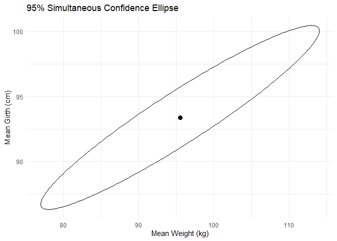
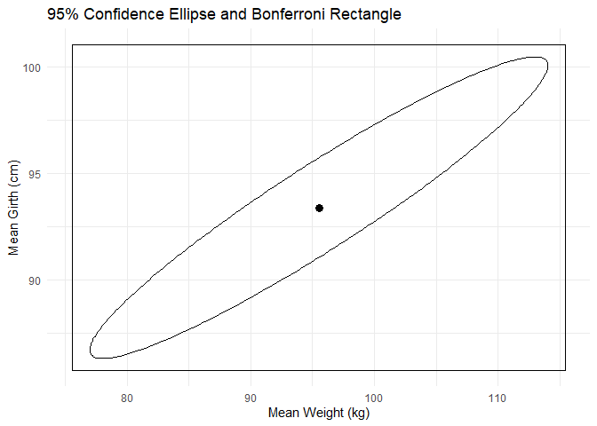
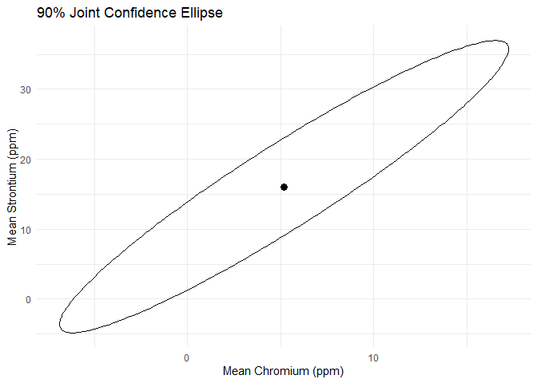
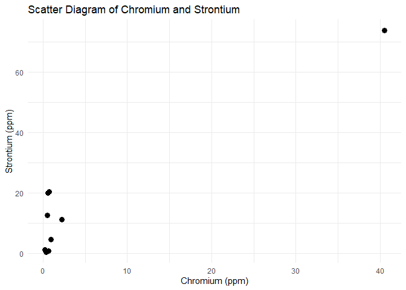
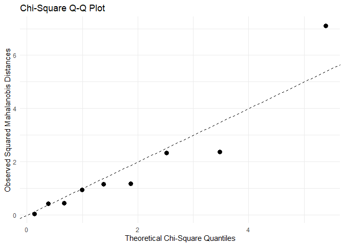
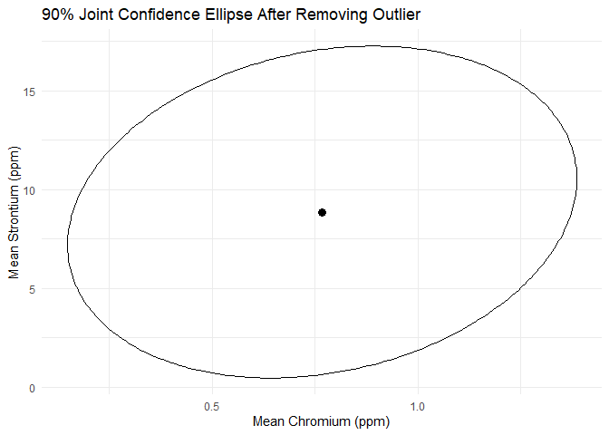
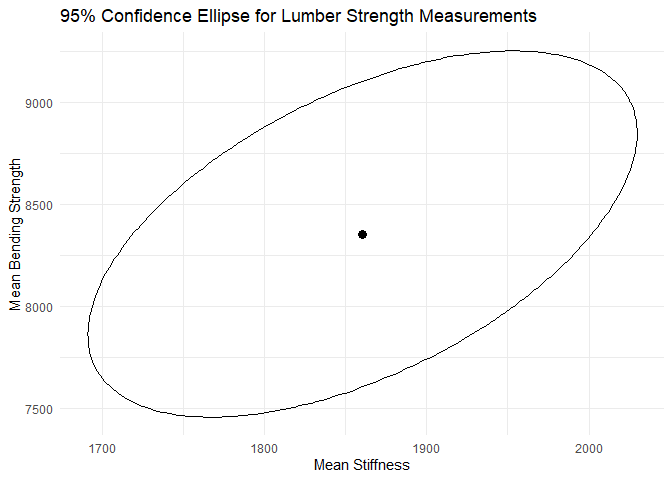
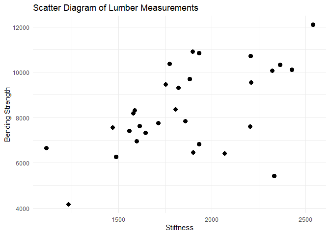
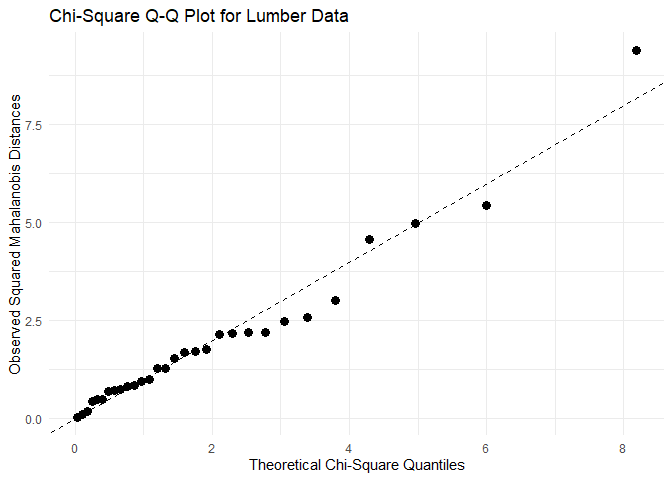

APM1220 - Applied Multivariate Data Analysis
================
Joseph Raphael M. Espiritu
2026-09-18

# 1. Hotelling’s T² Test for a Mean Vector

## 1.1 Problem Statement

The following data matrix contains observations on two variables:

$$X =
\begin{bmatrix}
2 & 12\\
8 & 9\\
6 & 9\\
8 & 10
\end{bmatrix}.$$

The objective is to evaluate Hotelling’s $T^2$ statistic for testing

$$H_0:\boldsymbol{\mu}
=
\begin{bmatrix}
7\\
11
\end{bmatrix}.$$

The significance level is

$$\alpha = 0.05.$$

## 1.2 Input Data

``` r
# Enter the observed data
X <- matrix(
  c(
    2, 12,
    8, 9,
    6, 9,
    8, 10
  ),
  ncol = 2,
  byrow = TRUE
)

# Assign variable names
colnames(X) <- c("X1", "X2")

# Display the data
X
```

    ##      X1 X2
    ## [1,]  2 12
    ## [2,]  8  9
    ## [3,]  6  9
    ## [4,]  8 10

The dataset contains $n=4$ observations and $p=2$ variables.

## 1.3 Sample Mean Vector

The sample mean vector is calculated using

$$\bar{\mathbf{x}}
=
\frac{1}{n}\sum_{i=1}^{n}\mathbf{x}_i.$$

``` r
# Number of observations
n <- nrow(X)

# Number of variables
p <- ncol(X)

# Calculate the sample mean vector
x_bar <- colMeans(X)

# Display the sample mean vector
x_bar
```

    ## X1 X2 
    ##  6 10

The resulting sample mean vector is

$$\bar{\mathbf{x}}
=
\begin{bmatrix}
6\\
10
\end{bmatrix}.$$

## 1.4 Sample Covariance Matrix

The sample covariance matrix is

$$S =
\frac{1}{n-1}
\sum_{i=1}^{n}
(\mathbf{x}_i-\bar{\mathbf{x}})
(\mathbf{x}_i-\bar{\mathbf{x}})'.$$

``` r
# Calculate the sample covariance matrix
S <- cov(X)

# Display the covariance matrix
S
```

    ##           X1        X2
    ## X1  8.000000 -3.333333
    ## X2 -3.333333  2.000000

The covariance matrix is

$$S =
\begin{bmatrix}
8 & -3.3333\\
-3.3333 & 2
\end{bmatrix}.$$

The negative off-diagonal element indicates a negative sample covariance
between $X_1$ and $X_2$.

## 1.5 Hotelling’s T² Statistic

For a one-sample Hotelling’s $T^2$ test,

$$T^2
=
n(\bar{\mathbf{x}}-\boldsymbol{\mu}_0)'
S^{-1}
(\bar{\mathbf{x}}-\boldsymbol{\mu}_0),$$

where

$$\boldsymbol{\mu}_0
=
\begin{bmatrix}
7\\
11
\end{bmatrix}.$$

``` r
# Specify the hypothesized population mean vector
mu_0 <- c(7, 11)

# Difference between the sample mean and hypothesized mean
mean_difference <- x_bar - mu_0

# Calculate the inverse of the covariance matrix
S_inverse <- solve(S)

# Calculate Hotelling's T² statistic
T2 <- n * t(mean_difference) %*%
  S_inverse %*%
  mean_difference

# Convert the result to a numeric value
T2 <- as.numeric(T2)

T2
```

    ## [1] 13.63636

The calculated Hotelling’s statistic is

$$\boxed{T^2 = 13.6364}.$$

## 1.6 Distribution Under the Null Hypothesis

For a sample from a multivariate normal population, under $H_0$,

$$\frac{n-p}{p(n-1)}T^2
\sim F_{p,n-p}.$$

Here,

$$n=4,\qquad p=2.$$

Therefore,

$$\frac{4-2}{2(4-1)}T^2
=
\frac{1}{3}T^2
\sim F_{2,2}.$$

``` r
# Convert Hotelling's T² statistic to an F statistic
F_stat <- ((n - p) / (p * (n - 1))) * T2

# Degrees of freedom
df1 <- p
df2 <- n - p

F_stat
```

    ## [1] 4.545455

Thus,

$$\boxed{F = 4.5455}$$

with degrees of freedom

$$\boxed{df_1=2,\quad df_2=2}.$$

## 1.7 Hypothesis Test at α = 0.05

The hypotheses are

$$H_0:\boldsymbol{\mu}
=
\begin{bmatrix}
7\\
11
\end{bmatrix}$$

versus

$$H_1:\boldsymbol{\mu}
\neq
\begin{bmatrix}
7\\
11
\end{bmatrix}.$$

The critical value is obtained from the $F$-distribution.

``` r
# Significance level
alpha <- 0.05

# Critical F value
F_critical <- qf(
  1 - alpha,
  df1 = df1,
  df2 = df2
)

# Calculate the p-value
p_value <- 1 - pf(
  F_stat,
  df1 = df1,
  df2 = df2
)

F_critical
```

    ## [1] 19

``` r
p_value
```

    ## [1] 0.1803279

The decision can be obtained using either the critical-value approach or
the p-value approach.

``` r
# Critical-value decision
if (F_stat > F_critical) {
  decision <- "Reject H0"
} else {
  decision <- "Fail to reject H0"
}

decision
```

    ## [1] "Fail to reject H0"

### Interpretation

At the $5\%$ significance level, the calculated statistic is

$$F = 4.5455.$$

The corresponding p-value is approximately

$$p = 0.180.$$

Since

$$p > 0.05,$$

we **fail to reject $H_0$**.

Therefore, based on this sample, there is **not sufficient statistical
evidence at the 5% significance level to conclude that the population
mean vector differs from**

$$\begin{bmatrix}
7\\
11
\end{bmatrix}.$$

This conclusion is specifically based on the Hotelling’s $T^2$ test and
the assumptions underlying its $F$-distribution.

# 2. Simultaneous Confidence Intervals and Regions for Grizzly Bear Body Measurements

The problem provides measurements from $n=61$ grizzly bears, consisting
of six body measurements: weight, body length, neck, girth, head length,
and head width.

The sample mean vector and covariance matrix are provided in the
assessment.

## 2.1 Input Summary Statistics

The six body measurements are weight, body length, neck, girth, head
length, and head width.

``` r
# Number of observations
n <- 61

# Number of variables
p <- 6

# Variable names
variables <- c(
  "Weight",
  "Body Length",
  "Neck",
  "Girth",
  "Head Length",
  "Head Width"
)

# Sample mean vector
x_bar <- c(
  95.52,
  164.38,
  55.69,
  93.39,
  17.98,
  31.13
)

# Sample covariance matrix
S <- matrix(
  c(
    3266.46, 1343.97, 731.54, 1175.50, 162.68, 238.37,
    1343.97, 721.91, 324.25, 537.35, 80.17, 117.73,
    731.54, 324.25, 179.28, 281.17, 39.15, 56.80,
    1175.50, 537.35, 281.17, 474.98, 63.73, 94.85,
    162.68, 80.17, 39.15, 63.73, 9.95, 13.88,
    238.37, 117.73, 56.80, 94.85, 13.88, 21.26
  ),
  nrow = 6,
  ncol = 6,
  byrow = TRUE
)

# Assign names
names(x_bar) <- variables
rownames(S) <- variables
colnames(S) <- variables

# Display the sample mean vector
x_bar
```

    ##      Weight Body Length        Neck       Girth Head Length  Head Width 
    ##       95.52      164.38       55.69       93.39       17.98       31.13

``` r
# Display the covariance matrix
S
```

    ##              Weight Body Length   Neck   Girth Head Length Head Width
    ## Weight      3266.46     1343.97 731.54 1175.50      162.68     238.37
    ## Body Length 1343.97      721.91 324.25  537.35       80.17     117.73
    ## Neck         731.54      324.25 179.28  281.17       39.15      56.80
    ## Girth       1175.50      537.35 281.17  474.98       63.73      94.85
    ## Head Length  162.68       80.17  39.15   63.73        9.95      13.88
    ## Head Width   238.37      117.73  56.80   94.85       13.88      21.26

The sample mean vector is

$$\bar{\mathbf{x}}
=
\begin{bmatrix}
95.52\\
164.38\\
55.69\\
93.39\\
17.98\\
31.13
\end{bmatrix}.$$

The covariance matrix is

$$S =
\begin{bmatrix}
3266.46 & 1343.97 & 731.54 & 1175.50 & 162.68 & 238.37\\
1343.97 & 721.91 & 324.25 & 537.35 & 80.17 & 117.73\\
731.54 & 324.25 & 179.28 & 281.17 & 39.15 & 56.80\\
1175.50 & 537.35 & 281.17 & 474.98 & 63.73 & 94.85\\
162.68 & 80.17 & 39.15 & 63.73 & 9.95 & 13.88\\
238.37 & 117.73 & 56.80 & 94.85 & 13.88 & 21.26
\end{bmatrix}.$$

## 2.2 Large-Sample 95% Simultaneous Confidence Intervals

The large-sample simultaneous confidence interval for each population
mean is

$$\bar{x}_j
\pm
\sqrt{
\frac{p(n-1)}{n-p}
F_{p,n-p}(1-\alpha)
\frac{s_{jj}}{n}
}.$$

For this problem,

$$n=61,\qquad p=6,\qquad \alpha=0.05.$$

``` r
# Significance level
alpha <- 0.05

# Critical F-value
F_critical <- qf(
  1 - alpha,
  df1 = p,
  df2 = n - p
)

# Standard errors
SE <- sqrt(diag(S) / n)

# Margin of error
ME <- sqrt(
  (p * (n - 1) / (n - p)) *
    F_critical *
    diag(S) / n
)

# Lower confidence limits
lower <- x_bar - ME

# Upper confidence limits
upper <- x_bar + ME

# Create confidence interval table
simultaneous_CI <- data.frame(
  Variable = variables,
  Mean = x_bar,
  SE = SE,
  Lower = lower,
  Upper = upper
)

# Round only the numeric columns
simultaneous_CI[-1] <- round(
  simultaneous_CI[-1],
  3
)

# Display results
simultaneous_CI
```

    ##                Variable   Mean    SE   Lower   Upper
    ## Weight           Weight  95.52 7.318  67.321 123.719
    ## Body Length Body Length 164.38 3.440 151.123 177.637
    ## Neck               Neck  55.69 1.714  49.084  62.296
    ## Girth             Girth  93.39 2.790  82.637 104.143
    ## Head Length Head Length  17.98 0.404  16.424  19.536
    ## Head Width   Head Width  31.13 0.590  28.855  33.405

The resulting intervals provide large-sample 95% simultaneous confidence
intervals for the six population means.

The simultaneous confidence intervals account for all six population
means being estimated at the same time. Therefore, the intervals provide
joint confidence coverage for the population mean vector.

## 2.3 Large-Sample 95% Simultaneous Confidence Ellipse for Mean Weight and Mean Girth

For this part, we consider mean weight and mean girth.

The corresponding sample mean vector is

$$\bar{\mathbf{x}}_{WG}
=
\begin{bmatrix}
95.52\\
93.39
\end{bmatrix}.$$

The corresponding covariance matrix is

$$S_{WG}
=
\begin{bmatrix}
3266.46 & 1175.50\\
1175.50 & 474.98
\end{bmatrix}.$$

``` r
# Select Weight and Girth
x_wg <- x_bar[c("Weight", "Girth")]

# Select the covariance matrix for Weight and Girth
S_wg <- S[
  c("Weight", "Girth"),
  c("Weight", "Girth")
]

# Display the selected mean vector
x_wg
```

    ## Weight  Girth 
    ##  95.52  93.39

``` r
# Display the selected covariance matrix
S_wg
```

    ##         Weight   Girth
    ## Weight 3266.46 1175.50
    ## Girth  1175.50  474.98

For two variables, the simultaneous confidence ellipse is based on

$$n(\bar{\mathbf{x}}-\boldsymbol{\mu})'
S^{-1}
(\bar{\mathbf{x}}-\boldsymbol{\mu})
\leq
\frac{p(n-1)}{n-p}
F_{p,n-p}(1-\alpha),$$

where $p=2$.

``` r
# Number of variables
p_ellipse <- 2

# Critical F-value
F_ellipse <- qf(
  1 - alpha,
  df1 = p_ellipse,
  df2 = n - p_ellipse
)

# Constant for the confidence ellipse
ellipse_constant <-
  (p_ellipse * (n - 1) / (n - p_ellipse)) *
  F_ellipse

# Eigenvalue decomposition
eigen_result <- eigen(S_wg)

# Generate angles
theta <- seq(
  0,
  2 * pi,
  length.out = 300
)

# Unit circle
circle <- rbind(
  cos(theta),
  sin(theta)
)

# Construct the confidence ellipse
ellipse <- t(
  matrix(
    x_wg,
    nrow = 2,
    ncol = length(theta)
  ) +
    sqrt(ellipse_constant / n) *
    eigen_result$vectors %*%
    diag(sqrt(eigen_result$values)) %*%
    circle
)

# Convert to data frame
ellipse_df <- data.frame(
  Weight = ellipse[, 1],
  Girth = ellipse[, 2]
)
```

### Plot of the Confidence Ellipse

``` r
library(ggplot2)

ggplot(
  ellipse_df,
  aes(
    x = Weight,
    y = Girth
  )
) +
  geom_path() +
  geom_point(
    aes(
      x = x_wg["Weight"],
      y = x_wg["Girth"]
    ),
    size = 3
  ) +
  labs(
    title = "95% Simultaneous Confidence Ellipse",
    x = "Mean Weight (kg)",
    y = "Mean Girth (cm)"
  ) +
  theme_minimal()
```

<!-- -->

### Interpretation

The confidence ellipse represents the set of plausible combinations of
the population mean weight and population mean girth.

The shape and orientation of the ellipse are influenced by the
covariance between weight and girth.

## 2.4 95% Bonferroni Confidence Intervals

For the six population means, the Bonferroni method uses

$$m=6.$$

The adjusted significance level is

$$\frac{\alpha}{m}
=
\frac{0.05}{6}.$$

The Bonferroni confidence interval is

$$\bar{x}_j
\pm
t_{1-\alpha/(2m),n-1}
\sqrt{\frac{s_{jj}}{n}}.$$

``` r
# Number of confidence intervals
m <- 6

# Bonferroni critical t-value
t_bonf <- qt(
  1 - alpha / (2 * m),
  df = n - 1
)

# Bonferroni margin of error
ME_bonf <- t_bonf * SE

# Lower confidence limits
lower_bonf <- x_bar - ME_bonf

# Upper confidence limits
upper_bonf <- x_bar + ME_bonf

# Create confidence interval table
bonferroni_CI <- data.frame(
  Variable = variables,
  Mean = x_bar,
  SE = SE,
  Lower = lower_bonf,
  Upper = upper_bonf
)

# Display results
bonferroni_CI[-1] <- round(
  bonferroni_CI[-1],
  3
)

bonferroni_CI
```

    ##                Variable   Mean    SE   Lower   Upper
    ## Weight           Weight  95.52 7.318  75.553 115.487
    ## Body Length Body Length 164.38 3.440 154.993 173.767
    ## Neck               Neck  55.69 1.714  51.012  60.368
    ## Girth             Girth  93.39 2.790  85.776 101.004
    ## Head Length Head Length  17.98 0.404  16.878  19.082
    ## Head Width   Head Width  31.13 0.590  29.519  32.741

### Interpretation

The Bonferroni confidence intervals provide simultaneous confidence
intervals for the six population means while accounting for multiple
comparisons.

The Bonferroni method adjusts the critical $t$-value based on the number
of intervals being constructed.

## 2.5 95% Bonferroni Confidence Rectangle

For mean weight and mean girth, the problem specifies

$$m=6.$$

The Bonferroni confidence rectangle is constructed by combining the
Bonferroni confidence intervals for mean weight and mean girth.

``` r
# Standard errors for Weight and Girth
SE_wg <- sqrt(diag(S_wg) / n)

# Lower confidence limits
wg_lower <- x_wg -
  t_bonf * SE_wg

# Upper confidence limits
wg_upper <- x_wg +
  t_bonf * SE_wg

# Display the confidence intervals
bonferroni_WG <- data.frame(
  Variable = c(
    "Weight",
    "Girth"
  ),
  Mean = x_wg,
  Lower = wg_lower,
  Upper = wg_upper
)

bonferroni_WG[-1] <- round(
  bonferroni_WG[-1],
  3
)

bonferroni_WG
```

    ##        Variable  Mean  Lower   Upper
    ## Weight   Weight 95.52 75.553 115.487
    ## Girth     Girth 93.39 85.776 101.004

The Bonferroni confidence rectangle can be compared with the
simultaneous confidence ellipse from part (b).

``` r
# Plot the confidence ellipse and Bonferroni rectangle

cebe <- ggplot(
  ellipse_df,
  aes(
    x = Weight,
    y = Girth
  )
) +
  geom_path() +
  geom_rect(
    aes(
      xmin = wg_lower["Weight"],
      xmax = wg_upper["Weight"],
      ymin = wg_lower["Girth"],
      ymax = wg_upper["Girth"]
    ),
    fill = NA,
    color = "black"
  ) +
  geom_point(
    aes(
      x = x_wg["Weight"],
      y = x_wg["Girth"]
    ),
    size = 3
  ) +
  labs(
    title = "95% Confidence Ellipse and Bonferroni Rectangle",
    x = "Mean Weight (kg)",
    y = "Mean Girth (cm)"
  ) +
  theme_minimal()

cebe
```

<!-- -->

### Interpretation

The confidence ellipse and Bonferroni rectangle represent two different
simultaneous confidence regions for the population mean weight and
population mean girth.

The ellipse accounts for the covariance between the two variables, while
the rectangle is constructed from the individual Bonferroni confidence
intervals.

## 2.6 95% Bonferroni Confidence Interval for Mean Head Width − Mean Head Length

The problem asks for the Bonferroni confidence interval for

$$\mu_{\text{Head Width}}
-
\mu_{\text{Head Length}}.$$

The problem specifies

$$m=6+1=7.$$

The estimated difference is

$$\bar{x}_{HW}
-
\bar{x}_{HL}.$$

``` r
# Calculate the difference between the sample means
difference <-
  x_bar["Head Width"] -
  x_bar["Head Length"]

difference
```

    ## Head Width 
    ##      13.15

Therefore,

$$\bar{x}_{HW}
-
\bar{x}_{HL}
=
31.13-17.98
=
13.15.$$

Since head width and head length are measured on the same bears, their
covariance must be included when calculating the standard error.

The standard error is

$$SE(\bar{x}_{HW}-\bar{x}_{HL})
=
\sqrt{
\frac{
s_{HW,HW}
+
s_{HL,HL}
-
2s_{HW,HL}
}{n}
}.$$

``` r
# Variance of Head Width
var_width <- S[
  "Head Width",
  "Head Width"
]

# Variance of Head Length
var_length <- S[
  "Head Length",
  "Head Length"
]

# Covariance between Head Width and Head Length
cov_width_length <- S[
  "Head Width",
  "Head Length"
]

# Standard error of the difference
SE_difference <- sqrt(
  (
    var_width +
      var_length -
      2 * cov_width_length
  ) / n
)

SE_difference
```

    ## [1] 0.2378179

Using $m=7$, the Bonferroni critical value is

$$t_{1-\alpha/(2m),n-1}.$$

``` r
# Number of statements
m_difference <- 7

# Bonferroni critical t-value
t_difference <- qt(
  1 - alpha / (2 * m_difference),
  df = n - 1
)

# Margin of error
ME_difference <-
  t_difference * SE_difference

# Lower confidence limit
difference_lower <-
  difference - ME_difference

# Upper confidence limit
difference_upper <-
  difference + ME_difference

# Create results table
difference_CI <- data.frame(
  Estimate = difference,
  Lower = difference_lower,
  Upper = difference_upper
)

# Display result
round(difference_CI, 3)
```

    ##            Estimate  Lower  Upper
    ## Head Width    13.15 12.488 13.812

### Interpretation

The resulting interval provides the 95% Bonferroni confidence interval
for the difference between the population mean head width and population
mean head length, using $m=7$ as specified in the problem.

If zero is contained within the confidence interval, zero is a plausible
value for the difference between the two population means. If zero is
outside the interval, the interval excludes equal population means.

# 3. Mineral Analysis of Ancient Peruvian Hairs

A physical anthropologist performed a mineral analysis of nine ancient
Peruvian hairs. The measurements are for chromium ($x_1$) and strontium
($x_2$), both measured in parts per million (ppm).

The objective of this problem is to analyze the population mean vector
of chromium and strontium using multivariate statistical methods.

## 3.1 Input Data

The chromium and strontium measurements for the nine ancient Peruvian
hairs are given below.

$$x_1 =
(0.48,\ 40.53,\ 2.19,\ 0.55,\ 0.74,\ 0.66,\ 0.93,\ 0.37,\ 0.22)$$

and

$$x_2 =
(12.57,\ 73.68,\ 11.13,\ 20.03,\ 20.29,\ 0.78,\ 4.64,\ 0.43,\ 1.08).$$

The data are assumed to represent a random sample from a particular
ancient Peruvian culture.

``` r
# Chromium measurements
x1 <- c(
  0.48,
  40.53,
  2.19,
  0.55,
  0.74,
  0.66,
  0.93,
  0.37,
  0.22
)

# Strontium measurements
x2 <- c(
  12.57,
  73.68,
  11.13,
  20.03,
  20.29,
  0.78,
  4.64,
  0.43,
  1.08
)

# Combine the variables into a data frame
hair_data <- data.frame(
  Chromium = x1,
  Strontium = x2
)

# Display the data
hair_data
```

    ##   Chromium Strontium
    ## 1     0.48     12.57
    ## 2    40.53     73.68
    ## 3     2.19     11.13
    ## 4     0.55     20.03
    ## 5     0.74     20.29
    ## 6     0.66      0.78
    ## 7     0.93      4.64
    ## 8     0.37      0.43
    ## 9     0.22      1.08

## 3.2 Sample Size and Number of Variables

There are $n=9$ observations and $p=2$ variables in the dataset.

``` r
# Number of observations
n <- nrow(hair_data)

# Number of variables
p <- ncol(hair_data)

# Display the sample size
n
```

    ## [1] 9

``` r
# Display the number of variables
p
```

    ## [1] 2

## 3.3 Sample Mean Vector

The sample mean vector is

$$\bar{\mathbf{x}}
=
\begin{bmatrix}
\bar{x}_1\\
\bar{x}_2
\end{bmatrix},$$

where $\bar{x}_1$ is the sample mean of chromium and $\bar{x}_2$ is the
sample mean of strontium.

The sample mean for each variable is calculated using

$$\bar{x}_j
=
\frac{1}{n}
\sum_{i=1}^{n}x_{ij}.$$

``` r
# Calculate the sample mean vector
x_bar <- colMeans(hair_data)

# Display the sample mean vector
x_bar
```

    ##  Chromium Strontium 
    ##  5.185556 16.070000

The sample mean vector is approximately

$$\bar{\mathbf{x}}
=
\begin{bmatrix}
5.1856\\
16.0700
\end{bmatrix}.$$

Therefore, the sample mean chromium level is approximately $5.19$ ppm,
while the sample mean strontium level is approximately $16.07$ ppm.

## 3.4 Sample Covariance Matrix

The sample covariance matrix is calculated using

$$S
=
\frac{1}{n-1}
\sum_{i=1}^{n}
(\mathbf{x}_i-\bar{\mathbf{x}})
(\mathbf{x}_i-\bar{\mathbf{x}})'.$$

The covariance matrix describes the variability of chromium and
strontium and their relationship within the sample.

``` r
# Calculate the sample covariance matrix
S <- cov(hair_data)

# Display the covariance matrix
S
```

    ##           Chromium Strontium
    ## Chromium  176.0042  287.2412
    ## Strontium 287.2412  527.8493

The sample covariance matrix is approximately

$$S
=
\begin{bmatrix}
176.0042 & 287.2412\\
287.2412 & 527.8493
\end{bmatrix}.$$

The positive covariance indicates a positive association between
chromium and strontium in the sample.

## 3(a) 90% Joint Confidence Ellipse

We construct a 90% joint confidence ellipse for the population mean
vector

$$\boldsymbol{\mu}
=
\begin{bmatrix}
\mu_1\\
\mu_2
\end{bmatrix},$$

where $\mu_1$ is the population mean chromium level and $\mu_2$ is the
population mean strontium level.

The Hotelling’s $T^2$ confidence region is given by

$$n(\bar{\mathbf{x}}-\boldsymbol{\mu})'
S^{-1}
(\bar{\mathbf{x}}-\boldsymbol{\mu})
\leq
\frac{p(n-1)}{n-p}
F_{p,n-p}(1-\alpha).$$

For a 90% confidence region,

$$\alpha=0.10.$$

Since there are two variables,

$$p=2,$$

and the sample size is

$$n=9.$$

``` r
# Significance level for a 90% confidence region
alpha <- 0.10

# Critical F-value
F_critical <- qf(
  1 - alpha,
  df1 = p,
  df2 = n - p
)

# Confidence region constant
ellipse_constant <-
  (p * (n - 1) / (n - p)) *
  F_critical

# Display the critical F-value
F_critical
```

    ## [1] 3.257442

``` r
# Display the confidence region constant
ellipse_constant
```

    ## [1] 7.445582

For this problem, the critical value is obtained from an
$F$-distribution with

$$df_1=p=2$$

and

$$df_2=n-p=7.$$

The confidence region constant is approximately

$$\frac{p(n-1)}{n-p}F_{p,n-p}(0.90)
=
7.4456.$$

The confidence ellipse can be constructed using the eigenvalue
decomposition of the covariance matrix.

The eigenvalues determine the lengths of the principal axes of the
ellipse, while the eigenvectors determine its orientation.

``` r
# Eigenvalue and eigenvector decomposition
eigen_result <- eigen(S)

# Display the eigenvalues
eigen_result$values
```

    ## [1] 688.75942  15.09406

``` r
# Display the eigenvectors
eigen_result$vectors
```

    ##           [,1]       [,2]
    ## [1,] 0.4887306 -0.8724347
    ## [2,] 0.8724347  0.4887306

The ellipse is generated by transforming points on a unit circle using
the eigenvalues and eigenvectors of the covariance matrix.

The center of the ellipse is the sample mean vector

$$\bar{\mathbf{x}}
=
\begin{bmatrix}
5.1856\\
16.0700
\end{bmatrix}.$$

``` r
# Generate angles around a circle
theta <- seq(
  0,
  2 * pi,
  length.out = 300
)

# Generate points on a unit circle
circle <- rbind(
  cos(theta),
  sin(theta)
)

# Construct the confidence ellipse
ellipse <- t(
  matrix(
    x_bar,
    nrow = 2,
    ncol = length(theta)
  ) +
    sqrt(ellipse_constant / n) *
    eigen_result$vectors %*%
    diag(sqrt(eigen_result$values)) %*%
    circle
)

# Convert ellipse coordinates to a data frame
ellipse_df <- data.frame(
  Chromium = ellipse[, 1],
  Strontium = ellipse[, 2]
)

# Display the first few ellipse coordinates
head(ellipse_df)
```

    ##   Chromium Strontium
    ## 1 16.85181  36.89547
    ## 2 16.78445  36.92716
    ## 3 16.71198  36.94964
    ## 4 16.63441  36.96290
    ## 5 16.55179  36.96694
    ## 6 16.46414  36.96175

### Plot of the 90% Joint Confidence Ellipse

The sample mean vector is plotted at the center of the confidence
ellipse.

``` r
# Load ggplot2
library(ggplot2)

# Plot the 90% joint confidence ellipse
ggplot(
  ellipse_df,
  aes(
    x = Chromium,
    y = Strontium
  )
) +
  geom_path() +
  geom_point(
    aes(
      x = x_bar["Chromium"],
      y = x_bar["Strontium"]
    ),
    size = 3
  ) +
  labs(
    title = "90% Joint Confidence Ellipse",
    x = "Mean Chromium (ppm)",
    y = "Mean Strontium (ppm)"
  ) +
  theme_minimal()
```

<!-- -->

### Interpretation

The 90% joint confidence ellipse represents the set of plausible values
for the population mean vector

$$\boldsymbol{\mu}
=
\begin{bmatrix}
\mu_1\\
\mu_2
\end{bmatrix}.$$

The center of the ellipse corresponds to the sample mean vector

$$\bar{\mathbf{x}}
=
\begin{bmatrix}
5.1856\\
16.0700
\end{bmatrix}.$$

The shape and orientation of the ellipse are determined by the
covariance between chromium and strontium. The ellipse provides a joint
representation of the uncertainty associated with estimating the two
population means.

## 3(b) Individual Simultaneous 90% Confidence Intervals

The simultaneous 90% confidence intervals for $\mu_1$ and $\mu_2$ can be
obtained by projecting the 90% joint confidence ellipse constructed in
part (a) onto each coordinate axis.

For each population mean, the simultaneous confidence interval is

$$\bar{x}_j
\pm
\sqrt{
\frac{p(n-1)}{n-p}
F_{p,n-p}(1-\alpha)
\frac{s_{jj}}{n}
}.$$

For this problem,

$$n=9,\qquad p=2,\qquad \alpha=0.10.$$

``` r
# Standard errors of the sample means
SE <- sqrt(
  diag(S) / n
)

# Simultaneous margin of error
ME <- sqrt(
  ellipse_constant *
    diag(S) / n
)

# Lower confidence limits
lower <- x_bar - ME

# Upper confidence limits
upper <- x_bar + ME

# Create confidence interval table
simultaneous_CI <- data.frame(
  Variable = c(
    "Chromium",
    "Strontium"
  ),
  Mean = x_bar,
  SE = SE,
  Lower = lower,
  Upper = upper
)

# Round only the numerical columns
simultaneous_CI[, -1] <- round(
  simultaneous_CI[, -1],
  3
)

# Display the confidence intervals
simultaneous_CI
```

    ##            Variable   Mean    SE  Lower  Upper
    ## Chromium   Chromium  5.186 4.422 -6.881 17.252
    ## Strontium Strontium 16.070 7.658 -4.827 36.967

The resulting simultaneous 90% confidence intervals give the plausible
ranges for the two population means.

For chromium,

$$L_1 < \mu_1 < U_1,$$

and for strontium,

$$L_2 < \mu_2 < U_2.$$

### Mean Strontium Level of 10

To determine whether a population mean strontium level of 10 is
plausible, we examine the simultaneous confidence interval for $\mu_2$.

The question is whether

$$\mu_2 = 10$$

is contained within the simultaneous 90% confidence interval for
strontium.

``` r
# Check whether a mean strontium level of 10
# is contained in the confidence interval
strontium_lower <- lower["Strontium"]
strontium_upper <- upper["Strontium"]

strontium_plausible <-
  10 >= strontium_lower &&
  10 <= strontium_upper

# Display the confidence interval
c(
  Lower = strontium_lower,
  Upper = strontium_upper
)
```

    ## Lower.Strontium Upper.Strontium 
    ##       -4.826957       36.966957

``` r
# Display whether 10 is inside the interval
strontium_plausible
```

    ## [1] TRUE

### Interpretation

Since $10$ lies within the simultaneous 90% confidence interval for
$\mu_2$, a population mean strontium level of 10 ppm is a plausible
value based on the confidence region.

Therefore, the data do not exclude

$$\mu_2=10$$

at the 90% simultaneous confidence level.

The problem also asks whether

$$\boldsymbol{\mu}_0
=
\begin{bmatrix}
0.30\\
10
\end{bmatrix}$$

is a plausible value for the population mean vector.

Because this is a joint question involving both population means, we
evaluate whether this point lies inside the 90% confidence ellipse.

``` r
# Candidate population mean vector
mu_candidate <- c(
  0.30,
  10
)

# Calculate the squared Mahalanobis distance
T2_candidate <- n *
  t(x_bar - mu_candidate) %*%
  solve(S) %*%
  (x_bar - mu_candidate)

# Convert to a numeric value
T2_candidate <- as.numeric(
  T2_candidate
)

# Display the T² value
T2_candidate
```

    ## [1] 1.772481

``` r
# Display the critical value
ellipse_constant
```

    ## [1] 7.445582

The candidate vector is inside the 90% confidence region when

$$T^2
\leq
\frac{p(n-1)}{n-p}
F_{p,n-p}(1-\alpha).$$

Therefore, we compare the calculated $T^2$ value with the
confidence-region constant obtained in part (a).

``` r
# Determine whether the candidate vector
# is inside the 90% confidence region
candidate_plausible <-
  T2_candidate <= ellipse_constant

# Display the decision
candidate_plausible
```

    ## [1] TRUE

### Interpretation

The candidate vector

$$\begin{bmatrix}
0.30\\
10
\end{bmatrix}$$

is evaluated using the joint confidence ellipse rather than by
considering the two means separately.

If the calculated $T^2$ value is less than or equal to the critical
value, the point lies inside the 90% confidence ellipse and is therefore
a plausible value for the population mean vector.

If the calculated $T^2$ value is greater than the critical value, the
point lies outside the confidence region and is not a plausible value
for the population mean vector at the 90% confidence level.

## 3(c) Assessment of Bivariate Normality

The bivariate normality assumption is assessed using a scatter diagram
and a Q-Q plot.

The scatter diagram is used to examine the relationship between chromium
and strontium and to identify any unusual observations.

For the multivariate Q-Q plot, the squared Mahalanobis distances are
compared with theoretical chi-square quantiles. If the observations
approximately follow a bivariate normal distribution, the points should
follow an approximately linear pattern.

``` r
# Scatter diagram of Chromium and Strontium

ggplot(
  hair_data,
  aes(
    x = Chromium,
    y = Strontium
  )
) +
  geom_point(size = 3) +
  labs(
    title = "Scatter Diagram of Chromium and Strontium",
    x = "Chromium (ppm)",
    y = "Strontium (ppm)"
  ) +
  theme_minimal()
```

<!-- -->

The scatter diagram can be examined for the overall relationship between
the two variables and for observations that appear separated from the
main group of observations.

``` r
# Calculate squared Mahalanobis distances
mahalanobis_dist <- mahalanobis(
  hair_data,
  center = x_bar,
  cov = S
)

# Sort the observed distances
mahalanobis_sorted <- sort(
  mahalanobis_dist
)

# Calculate theoretical chi-square quantiles
theoretical_quantiles <- qchisq(
  ppoints(n),
  df = p
)

# Create Q-Q plot data
qq_data <- data.frame(
  Theoretical = theoretical_quantiles,
  Observed = mahalanobis_sorted
)

# Display the Q-Q plot
ggplot(
  qq_data,
  aes(
    x = Theoretical,
    y = Observed
  )
) +
  geom_point(size = 3) +
  geom_abline(
    intercept = 0,
    slope = 1,
    linetype = "dashed"
  ) +
  labs(
    title = "Chi-Square Q-Q Plot",
    x = "Theoretical Chi-Square Quantiles",
    y = "Observed Squared Mahalanobis Distances"
  ) +
  theme_minimal()
```

<!-- -->

### Interpretation

The scatter diagram shows that most observations are concentrated in a
relatively small region, while the observation corresponding to

$$(40.53,\ 73.68)$$

is noticeably separated from the remaining observations.

The Q-Q plot should also be examined for departures from the approximate
linear pattern. The extreme observation produces a large Mahalanobis
distance and contributes to the departure from the expected pattern.

Therefore, the data do not appear to follow the bivariate normal model
particularly well because of the apparent outlying observation.

If the population is not bivariate normal, the theoretical confidence
ellipse and simultaneous confidence intervals may not have their
intended confidence level. The results in parts (a) and (b) should
therefore be interpreted with caution.

## 3(d) Analysis After Removing the Outlying Observation

The observation

$$(40.53,\ 73.68)$$

is treated as the obvious outlying observation.

The analysis from parts (a) and (b) is repeated after removing this
observation. We first recalculate the sample mean vector and covariance
matrix.

``` r
# Remove the second observation
hair_data_clean <- hair_data[-2, ]

# Display the remaining observations
hair_data_clean
```

    ##   Chromium Strontium
    ## 1     0.48     12.57
    ## 3     2.19     11.13
    ## 4     0.55     20.03
    ## 5     0.74     20.29
    ## 6     0.66      0.78
    ## 7     0.93      4.64
    ## 8     0.37      0.43
    ## 9     0.22      1.08

The sample size after removing the outlying observation is

$$n=8.$$

The number of variables remains

$$p=2.$$

``` r
# Updated sample size
n_clean <- nrow(hair_data_clean)

# Number of variables
p_clean <- ncol(hair_data_clean)

# Calculate the new sample mean vector
x_bar_clean <- colMeans(
  hair_data_clean
)

# Calculate the new covariance matrix
S_clean <- cov(
  hair_data_clean
)

# Display the new sample size
n_clean
```

    ## [1] 8

``` r
# Display the new sample mean vector
x_bar_clean
```

    ##  Chromium Strontium 
    ##   0.76750   8.86875

``` r
# Display the new covariance matrix
S_clean
```

    ##            Chromium Strontium
    ## Chromium  0.3785643  1.030282
    ## Strontium 1.0302821 69.859755

The new sample mean vector is approximately

$$\bar{\mathbf{x}}_{\text{clean}}
=
\begin{bmatrix}
0.7675\\
8.8688
\end{bmatrix}.$$

The removal of the outlying observation substantially changes the sample
mean vector.

### 90% Joint Confidence Ellipse After Removing the Outlier

A new 90% joint confidence ellipse is constructed using the updated
sample size, mean vector, and covariance matrix.

The confidence region is

$$n(\bar{\mathbf{x}}-\boldsymbol{\mu})'
S^{-1}
(\bar{\mathbf{x}}-\boldsymbol{\mu})
\leq
\frac{p(n-1)}{n-p}
F_{p,n-p}(1-\alpha).$$

For the cleaned data,

$$n=8,\qquad p=2,\qquad \alpha=0.10.$$

``` r
# Significance level
alpha <- 0.10

# Critical F-value for the cleaned data
F_clean <- qf(
  1 - alpha,
  df1 = p_clean,
  df2 = n_clean - p_clean
)

# Confidence region constant
ellipse_constant_clean <-
  (p_clean * (n_clean - 1) /
     (n_clean - p_clean)) *
  F_clean

# Display the critical value
F_clean
```

    ## [1] 3.463304

``` r
# Display the confidence region constant
ellipse_constant_clean
```

    ## [1] 8.081043

The eigenvalue decomposition of the new covariance matrix is then used
to construct the ellipse.

``` r
# Eigenvalue decomposition
eigen_clean <- eigen(
  S_clean
)

# Generate angles
theta_clean <- seq(
  0,
  2 * pi,
  length.out = 300
)

# Generate points on a unit circle
circle_clean <- rbind(
  cos(theta_clean),
  sin(theta_clean)
)

# Construct the new confidence ellipse
ellipse_clean <- t(
  matrix(
    x_bar_clean,
    nrow = 2,
    ncol = length(theta_clean)
  ) +
    sqrt(
      ellipse_constant_clean / n_clean
    ) *
    eigen_clean$vectors %*%
    diag(
      sqrt(eigen_clean$values)
    ) %*%
    circle_clean
)

# Convert to a data frame
ellipse_clean_df <- data.frame(
  Chromium = ellipse_clean[, 1],
  Strontium = ellipse_clean[, 2]
)

# Display the first few coordinates
head(ellipse_clean_df)
```

    ##    Chromium Strontium
    ## 1 0.8920362  17.26919
    ## 2 0.8792811  17.26752
    ## 3 0.8664767  17.26215
    ## 4 0.8536286  17.25307
    ## 5 0.8407425  17.24028
    ## 6 0.8278240  17.22380

``` r
# Plot the confidence ellipse after removing the outlier

ggplot(
  ellipse_clean_df,
  aes(
    x = Chromium,
    y = Strontium
  )
) +
  geom_path() +
  geom_point(
    aes(
      x = x_bar_clean["Chromium"],
      y = x_bar_clean["Strontium"]
    ),
    size = 3
  ) +
  labs(
    title = "90% Joint Confidence Ellipse After Removing Outlier",
    x = "Mean Chromium (ppm)",
    y = "Mean Strontium (ppm)"
  ) +
  theme_minimal()
```

<!-- -->

### Simultaneous 90% Confidence Intervals After Removing the Outlier

The individual simultaneous 90% confidence intervals are recalculated
using the updated covariance matrix and sample size.

``` r
# Standard errors
SE_clean <- sqrt(
  diag(S_clean) / n_clean
)

# Simultaneous margin of error
ME_clean <- sqrt(
  ellipse_constant_clean *
    diag(S_clean) / n_clean
)

# Lower confidence limits
lower_clean <- x_bar_clean -
  ME_clean

# Upper confidence limits
upper_clean <- x_bar_clean +
  ME_clean

# Create confidence interval table
simultaneous_CI_clean <- data.frame(
  Variable = c(
    "Chromium",
    "Strontium"
  ),
  Mean = x_bar_clean,
  SE = SE_clean,
  Lower = lower_clean,
  Upper = upper_clean
)

# Round only numerical columns
simultaneous_CI_clean[, -1] <-
  round(
    simultaneous_CI_clean[, -1],
    3
  )

# Display results
simultaneous_CI_clean
```

    ##            Variable  Mean    SE Lower  Upper
    ## Chromium   Chromium 0.767 0.218 0.149  1.386
    ## Strontium Strontium 8.869 2.955 0.468 17.269

### Comparison of the Inferences

The original analysis included the observation

$$(40.53,\ 73.68),$$

while the second analysis removes this observation.

The two analyses can be compared using their sample mean vectors and
simultaneous confidence intervals.

``` r
# Original sample means
original_means <- x_bar

# Cleaned sample means
cleaned_means <- x_bar_clean

# Create a comparison table
comparison_means <- data.frame(
  Variable = c(
    "Chromium",
    "Strontium"
  ),
  Original = original_means,
  Without_Outlier = cleaned_means
)

# Round numerical columns
comparison_means[, -1] <-
  round(
    comparison_means[, -1],
    3
  )

# Display comparison
comparison_means
```

    ##            Variable Original Without_Outlier
    ## Chromium   Chromium    5.186           0.767
    ## Strontium Strontium   16.070           8.869

### Interpretation

Removing the outlying observation changes the sample mean vector
substantially.

The original sample mean vector is approximately

$$\bar{\mathbf{x}}
=
\begin{bmatrix}
5.1856\\
16.0700
\end{bmatrix},$$

whereas after removing the outlier,

$$\bar{\mathbf{x}}_{\text{clean}}
=
\begin{bmatrix}
0.7675\\
8.8688
\end{bmatrix}.$$

The confidence ellipse and simultaneous confidence intervals also change
because both the sample mean vector and covariance matrix are affected
by the outlying observation.

Therefore, the inferences from parts (a) and (b) are sensitive to the
presence of the outlier. This demonstrates the importance of examining
the data for unusual observations when performing multivariate
statistical inference.

## 3.5 Overall Conclusion

The analysis of the ancient Peruvian hair data shows that the
observation

$$(40.53,\ 73.68)$$

has a substantial influence on the multivariate analysis.

The scatter diagram and Q-Q plot indicate that this observation is
unusual relative to the remaining observations. After removing it, the
sample mean vector, covariance matrix, confidence ellipse, and
simultaneous confidence intervals change substantially.

Therefore, the results of the original confidence-region analysis should
be interpreted together with the assessment of bivariate normality and
the influence of the outlying observation.

# 4. Lumber Strength Measurements

The data consist of measurements of $x_1$, stiffness (modulus of
elasticity), and $x_2$, bending strength, for a sample of $n=30$ pieces
of a particular grade of lumber.

The measurements are given in pounds per square inch
$\left(\text{lb}/\text{in}^2\right)$.

The objective is to construct a 95% confidence ellipse for the
population mean vector, evaluate whether the data are consistent with
typical values for stiffness and bending strength, and assess whether a
bivariate normal distribution is a reasonable population model.

## 4.2 Input Data

The 30 observations are entered into R as two variables:

$$x_1=\text{Stiffness}$$

and

$$x_2=\text{Bending Strength}.$$

``` r
# Stiffness measurements
x1 <- c(
  1232, 1115, 2205, 1897, 1932,
  1612, 1598, 1804, 1752, 2067,
  2365, 1646, 1579, 1880, 1773,
  1712, 1932, 1820, 1900, 2426,
  1558, 1470, 1858, 1587, 2208,
  1487, 2206, 2332, 2540, 2322
)

# Bending strength measurements
x2 <- c(
  4175, 6652, 7612, 10914, 10850,
  7627, 6954, 8365, 9469, 6410,
  10327, 7320, 8196, 9709, 10370,
  7749, 6818, 9307, 6457, 10102,
  7414, 7556, 7833, 8309, 9559,
  6255, 10723, 5430, 12090, 10072
)

# Combine the measurements into a data frame
lumber_data <- data.frame(
  Stiffness = x1,
  Bending_Strength = x2
)

# Display the data
lumber_data
```

    ##    Stiffness Bending_Strength
    ## 1       1232             4175
    ## 2       1115             6652
    ## 3       2205             7612
    ## 4       1897            10914
    ## 5       1932            10850
    ## 6       1612             7627
    ## 7       1598             6954
    ## 8       1804             8365
    ## 9       1752             9469
    ## 10      2067             6410
    ## 11      2365            10327
    ## 12      1646             7320
    ## 13      1579             8196
    ## 14      1880             9709
    ## 15      1773            10370
    ## 16      1712             7749
    ## 17      1932             6818
    ## 18      1820             9307
    ## 19      1900             6457
    ## 20      2426            10102
    ## 21      1558             7414
    ## 22      1470             7556
    ## 23      1858             7833
    ## 24      1587             8309
    ## 25      2208             9559
    ## 26      1487             6255
    ## 27      2206            10723
    ## 28      2332             5430
    ## 29      2540            12090
    ## 30      2322            10072

## 4.3 Sample Size and Number of Variables

There are $n=30$ observations and $p=2$ variables.

The sample mean vector and sample covariance matrix will be calculated
from the data.

``` r
# Number of observations
n <- nrow(lumber_data)

# Number of variables
p <- ncol(lumber_data)

# Display the sample size
n
```

    ## [1] 30

``` r
# Display the number of variables
p
```

    ## [1] 2

## 4.4 Sample Mean Vector

The sample mean vector is

$$\bar{\mathbf{x}}
=
\begin{bmatrix}
\bar{x}_1\\
\bar{x}_2
\end{bmatrix}.$$

The sample means are calculated using

$$\bar{x}_j
=
\frac{1}{n}
\sum_{i=1}^{n}x_{ij}.$$

``` r
# Calculate the sample mean vector
x_bar <- colMeans(lumber_data)

# Display the sample mean vector
x_bar
```

    ##        Stiffness Bending_Strength 
    ##         1860.500         8354.133

The sample mean vector gives the average stiffness and average bending
strength observed in the sample.

## 4.5 Sample Covariance Matrix

The sample covariance matrix is

$$S
=
\frac{1}{n-1}
\sum_{i=1}^{n}
(\mathbf{x}_i-\bar{\mathbf{x}})
(\mathbf{x}_i-\bar{\mathbf{x}})'.$$

The covariance matrix measures the variability of stiffness and bending
strength and their covariance.

``` r
# Calculate the sample covariance matrix
S <- cov(lumber_data)

# Display the covariance matrix
S
```

    ##                  Stiffness Bending_Strength
    ## Stiffness         124054.7         361620.4
    ## Bending_Strength  361620.4        3486333.2

## 4(a) 95% Confidence Ellipse

We construct a 95% confidence ellipse for the population mean vector

$$\boldsymbol{\mu}
=
\begin{bmatrix}
\mu_1\\
\mu_2
\end{bmatrix},$$

where

$$\mu_1=E(X_1)$$

represents the population mean stiffness and

$$\mu_2=E(X_2)$$

represents the population mean bending strength.

For a sample from a bivariate normal population, the 95% confidence
region is based on Hotelling’s $T^2$ statistic:

$$n(\bar{\mathbf{x}}-\boldsymbol{\mu})'
S^{-1}
(\bar{\mathbf{x}}-\boldsymbol{\mu})
\leq
\frac{p(n-1)}{n-p}
F_{p,n-p}(1-\alpha).$$

For this problem,

$$n=30,\qquad p=2,\qquad \alpha=0.05.$$

``` r
# Significance level
alpha <- 0.05

# Critical F-value
F_critical <- qf(
  1 - alpha,
  df1 = p,
  df2 = n - p
)

# Confidence region constant
ellipse_constant <-
  (p * (n - 1) / (n - p)) *
  F_critical

# Display the critical F-value
F_critical
```

    ## [1] 3.340386

``` r
# Display the confidence region constant
ellipse_constant
```

    ## [1] 6.91937

The critical value is obtained from an $F$-distribution with

$$df_1=p=2$$

and

$$df_2=n-p=28.$$

The confidence region constant is used to determine the boundary of the
95% confidence ellipse.

The confidence ellipse is constructed using the eigenvalue decomposition
of the sample covariance matrix.

The eigenvalues determine the lengths of the principal axes, while the
eigenvectors determine the orientation of the ellipse.

``` r
# Eigenvalue and eigenvector decomposition
eigen_result <- eigen(S)

# Display the eigenvalues
eigen_result$values
```

    ## [1] 3524786.45   85601.38

``` r
# Display the eigenvectors
eigen_result$vectors
```

    ##           [,1]       [,2]
    ## [1,] 0.1057399 -0.9943938
    ## [2,] 0.9943938  0.1057399

Points on a unit circle are transformed using the eigenvalues and
eigenvectors of $S$. The resulting ellipse is centered at the sample
mean vector $\bar{\mathbf{x}}$.

``` r
# Generate angles around a circle
theta <- seq(
  0,
  2 * pi,
  length.out = 300
)

# Generate points on a unit circle
circle <- rbind(
  cos(theta),
  sin(theta)
)

# Construct the confidence ellipse
ellipse <- t(
  matrix(
    x_bar,
    nrow = 2,
    ncol = length(theta)
  ) +
    sqrt(ellipse_constant / n) *
    eigen_result$vectors %*%
    diag(sqrt(eigen_result$values)) %*%
    circle
)

# Convert ellipse coordinates into a data frame
ellipse_df <- data.frame(
  Stiffness = ellipse[, 1],
  Bending_Strength = ellipse[, 2]
)

# Display the first few coordinates
head(ellipse_df)
```

    ##   Stiffness Bending_Strength
    ## 1  1955.841         9250.731
    ## 2  1952.884         9250.845
    ## 3  1949.886         9250.563
    ## 4  1946.849         9249.886
    ## 5  1943.773         9248.813
    ## 6  1940.661         9247.344

### Plot of the 95% Confidence Ellipse

The sample mean vector is plotted at the center of the confidence
ellipse.

``` r
# Load ggplot2
library(ggplot2)

# Plot the 95% confidence ellipse
ggplot(
  ellipse_df,
  aes(
    x = Stiffness,
    y = Bending_Strength
  )
) +
  geom_path() +
  geom_point(
    aes(
      x = x_bar["Stiffness"],
      y = x_bar["Bending_Strength"]
    ),
    size = 3
  ) +
  labs(
    title = "95% Confidence Ellipse for Lumber Strength Measurements",
    x = "Mean Stiffness",
    y = "Mean Bending Strength"
  ) +
  theme_minimal()
```

<!-- -->

### Interpretation

The 95% confidence ellipse represents the set of plausible values for
the population mean vector

$$\boldsymbol{\mu}
=
\begin{bmatrix}
\mu_1\\
\mu_2
\end{bmatrix}.$$

The center of the ellipse corresponds to the sample mean vector.

The orientation of the ellipse reflects the covariance between stiffness
and bending strength, while its size represents the uncertainty in
estimating the population mean vector.

The ellipse can also be used to evaluate whether particular proposed
values of the population means are consistent with the observed data.

## 4(b) Assessment of the Typical Values

Suppose the typical population mean values are

$$\boldsymbol{\mu}_0
=
\begin{bmatrix}
2000\\
10000
\end{bmatrix}.$$

We can determine whether these values are consistent with the data by
checking whether this point lies inside the 95% confidence ellipse.

The squared Mahalanobis distance is

$$T^2
=
n(\bar{\mathbf{x}}-\boldsymbol{\mu}_0)'
S^{-1}
(\bar{\mathbf{x}}-\boldsymbol{\mu}_0).$$

The proposed mean vector is consistent with the 95% confidence region if

$$T^2
\leq
\frac{p(n-1)}{n-p}
F_{p,n-p}(1-\alpha).$$

``` r
# Proposed typical population mean vector
mu_0 <- c(
  2000,
  10000
)

# Assign names
names(mu_0) <- c(
  "Stiffness",
  "Bending_Strength"
)

# Calculate the squared Mahalanobis distance
T2_typical <- n *
  t(x_bar - mu_0) %*%
  solve(S) %*%
  (x_bar - mu_0)

# Convert to numeric
T2_typical <- as.numeric(
  T2_typical
)

# Display the calculated T² value
T2_typical
```

    ## [1] 23.64778

``` r
# Display the critical value
ellipse_constant
```

    ## [1] 6.91937

``` r
# Determine whether the typical values
# are inside the 95% confidence region
typical_values_consistent <-
  T2_typical <= ellipse_constant

# Display the result
typical_values_consistent
```

    ## [1] FALSE

### Interpretation

The proposed population mean vector

$$\boldsymbol{\mu}_0
=
\begin{bmatrix}
2000\\
10000
\end{bmatrix}$$

is compared with the 95% confidence ellipse.

If the point lies inside the ellipse, the proposed values are consistent
with the observed data at the 95% confidence level.

If the point lies outside the ellipse, the proposed values are not
contained in the 95% confidence region.

The result from the R calculation above provides the basis for the
conclusion.

## 4(c) Assessment of Bivariate Normality

The bivariate normality assumption can be assessed using a scatter
diagram and a multivariate Q-Q plot.

The scatter diagram is used to examine the relationship between
stiffness and bending strength and to identify any unusual observations.

For the Q-Q plot, the squared Mahalanobis distances are compared with
theoretical chi-square quantiles. If the data are approximately
bivariate normal, the points should follow an approximately
straight-line pattern.

``` r
# Scatter diagram of stiffness and bending strength

ggplot(
  lumber_data,
  aes(
    x = Stiffness,
    y = Bending_Strength
  )
) +
  geom_point(size = 3) +
  labs(
    title = "Scatter Diagram of Lumber Measurements",
    x = "Stiffness",
    y = "Bending Strength"
  ) +
  theme_minimal()
```

<!-- -->

The scatter diagram shows the overall relationship between stiffness and
bending strength.

The plot should also be examined for observations that are unusually
distant from the main group of observations.

``` r
# Calculate squared Mahalanobis distances
mahalanobis_dist <- mahalanobis(
  lumber_data,
  center = x_bar,
  cov = S
)

# Sort the observed distances
mahalanobis_sorted <- sort(
  mahalanobis_dist
)

# Calculate theoretical chi-square quantiles
theoretical_quantiles <- qchisq(
  ppoints(n),
  df = p
)

# Create Q-Q plot data
qq_data <- data.frame(
  Theoretical = theoretical_quantiles,
  Observed = mahalanobis_sorted
)

# Create the Q-Q plot
ggplot(
  qq_data,
  aes(
    x = Theoretical,
    y = Observed
  )
) +
  geom_point(size = 3) +
  geom_abline(
    intercept = 0,
    slope = 1,
    linetype = "dashed"
  ) +
  labs(
    title = "Chi-Square Q-Q Plot for Lumber Data",
    x = "Theoretical Chi-Square Quantiles",
    y = "Observed Squared Mahalanobis Distances"
  ) +
  theme_minimal()
```

<!-- -->

### Interpretation

The scatter diagram and Q-Q plot are used together to assess whether a
bivariate normal population model is reasonable for the lumber
measurements.

If the scatter diagram shows an approximately elliptical pattern without
extreme observations, this supports the bivariate normal model.

For the Q-Q plot, observations that approximately follow a straight-line
pattern provide support for the bivariate normal assumption. Large
departures from the pattern or extreme observations may indicate that
the assumption is questionable.

The results of the Q-Q plot and scatter diagram should therefore be
considered when interpreting the confidence ellipse from part (a).

## 4.4 Overall Conclusion

The lumber data were analyzed using multivariate methods for the
population mean vector of stiffness and bending strength.

A 95% joint confidence ellipse was constructed for

$$\boldsymbol{\mu}
=
\begin{bmatrix}
\mu_1\\
\mu_2
\end{bmatrix}.$$

The proposed typical values

$$\begin{bmatrix}
2000\\
10000
\end{bmatrix}$$

were then evaluated by determining whether the point lies within the 95%
confidence region.

Finally, the bivariate normality assumption was assessed using a scatter
diagram and a chi-square Q-Q plot. These graphical diagnostics are
important because the theoretical confidence ellipse relies on the
assumption that the population is reasonably modeled by a bivariate
normal distribution.
